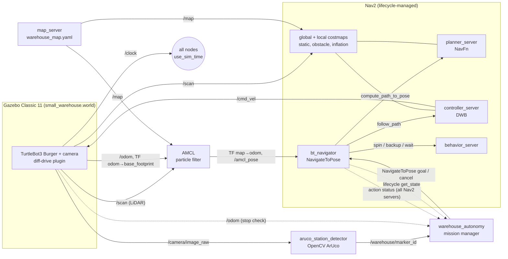
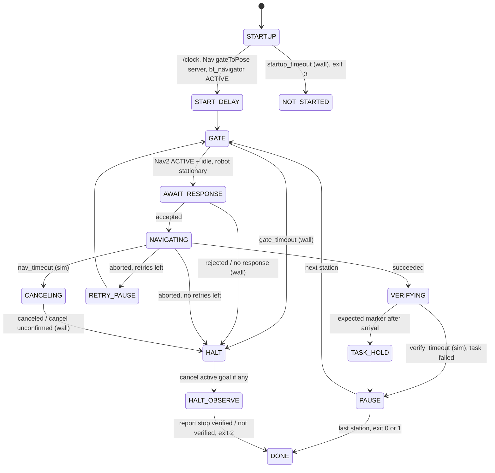

# Autonomous Warehouse Inspection Robot (ROS 2 Humble, Nav2, ArUco)


A simulated TurtleBot3 inspects a warehouse on its own. It localizes on a saved map with
AMCL, navigates to four stations with Nav2, confirms that it reached each one by reading
that station's ArUco marker with its camera, and returns to its charging dock. A
supervising mission manager runs the five-step mission. It refuses to send a goal while
Nav2 is still busy or the robot is still moving, bounds every wait, and reports
exactly how many tasks succeeded, failed, or were never attempted.

The project is a **simulation portfolio system**, built and debugged on Ubuntu 22.04 under
WSL2. It is engineered and tested with care, but it is not a production or
safety-certified autonomy stack. [Limitations](#limitations) lists what is and is not
demonstrated.

---

## Demonstration


https://github.com/user-attachments/assets/dd67f2da-6fb0-4903-81f8-b93f97a8f34c

Mission summary printed by the mission manager in the final validation run, Trial 12 (process exit code 0; see [results](#experimental-results)):

```
WAREHOUSE MISSION COMPLETE: ALL TASKS SUCCEEDED
Total mission steps: 5
Successful tasks: 5
Failed tasks: 0
Unattempted tasks: 0
```

The screenshot and video above predate the supervision work. A current demo video should
show the RViz plan and costmaps during one full mission, the detector window confirming
each marker, the terminal summary with the process exit code, and, as a second clip, one
fault test (for example `pytest -k lifecycle`) to show the supervision behaviour.

---

## What the robot does

| Step | Station | Goal (map frame) | Verified by |
|---|---|---|---|
| 1 | Home Charging Dock | (-3.68, 9.30), facing +y | ArUco ID 0 |
| 2 | Loading Zone | (1.80, 9.30), facing +y | ArUco ID 1 |
| 3 | Inventory Scan Station | (1.80, -9.00), facing -y | ArUco ID 2 |
| 4 | Dispatch Zone | (-3.63, -9.30), facing -y | ArUco ID 3 |
| 5 | Return to Home Charging Dock | (-3.68, 9.30), facing +y | ArUco ID 0 |

The robot spawns at the origin. For each step the mission manager sends a `NavigateToPose`
goal. On arrival it waits up to 15 s (simulation time) for the expected marker ID. Only
detections received after arrival count. A failed marker check fails that task and the
mission continues. A failed navigation is retried once; if the retry also fails, the
mission halts. The markers are 0.28 m DICT_5X5_50 tags on the warehouse walls, about
0.67–0.97 m in front of the goal poses.

---

## System architecture



The camera branch verifies stations; navigation itself uses only the LiDAR, the map and
odometry. Dotted lines are the mission manager's **passive supervision** inputs. It never
publishes velocity commands.

### Mission state machine



A clock-stall watchdog that halts the mission can fire from any active state. Ctrl+C or
SIGTERM cancels an active or pending goal before exiting with code 130.

---

## Packages and key files

| Package / path | Purpose |
|---|---|
| `src/warehouse_bringup/` | Mission manager, launch files, saved map |
| `  warehouse_bringup/warehouse_autonomy_node.py` | Mission state machine (`ros2 run warehouse_bringup warehouse_autonomy`) |
| `  warehouse_bringup/nav2_supervision.py` | Passive helpers: Nav2 action-activity tracker, odometry stop tracker |
| `  launch/warehouse_robot_system_camera.launch.py` | Full system: Gazebo, robot, Nav2 + RViz (t=40 s), detector (t=55 s) |
| `  launch/warehouse_simulation_camera.launch.py` | Gazebo, robot_state_publisher, spawn `turtlebot3_burger_cam` at (0, 0) |
| `  launch/warehouse_navigation.launch.py` | Nav2 with the warehouse map (`turtlebot3_navigation2`) |
| `  maps/warehouse_map.{pgm,yaml}` | 318 × 439 cells at 0.05 m, origin (-7.56, -10.8) |
| `  test/` | 27 mission-manager tests against a mock Nav2, 2 tracker unit tests, lint tests |
| `src/warehouse_perception/` | `aruco_station_detector`: DICT_5X5_50, OpenCV 4.5.4 and ≥ 4.7 APIs |
| `src/warehouse_gazebo/` | Warehouse world, AWS RoboMaker models, ArUco marker models and generator |
| `src/turtlebot3/` | Vendored ROBOTIS TurtleBot3 packages; overrides apt. Holds the tuned Nav2 parameters |
| `  turtlebot3_navigation2/param/humble/burger_cam.yaml` | AMCL, costmap, NavFn, DWB, behavior-server parameters used at runtime |
| `scripts/run_mission_trial.sh` | Controlled end-to-end trial: fresh launch, readiness checks, mission, metrics |
| `scripts/trial_metrics.py` | Counts comparable metrics from saved trial logs |
| `docs/trial_results.md` | Metrics table and notes for every recorded trial |
| `scripts/legacy/` | Earlier trial runners (Trials 02–10), kept so the historical logs stay reproducible |
| `audit_logs/` | Raw launch, mission and metadata logs from every trial |

`src/aws-robomaker-small-warehouse-world/` is an upstream copy kept for reference; it is
not built (`COLCON_IGNORE`). `warehouse_gazebo/launch/turtlebot3_*warehouse.launch.py` are
early bring-up files that the system launch does not use.

### Interfaces used by the mission manager

| Interface | Type | Role |
|---|---|---|
| `navigate_to_pose` | `nav2_msgs/action/NavigateToPose` | Station goals, cancellation |
| `/<server>/_action/status` | `action_msgs/msg/GoalStatusArray` | Is any Nav2 server (navigate_to_pose, follow_path, compute_path_to_pose, spin, backup, wait, drive_on_heading) still executing? |
| `/bt_navigator/get_state` | `lifecycle_msgs/srv/GetState` | Nav2 must be ACTIVE before each goal |
| `/odom` | `nav_msgs/msg/Odometry` | Stationary before each goal; stop report after a halt |
| `/warehouse/marker_id` | `std_msgs/msg/Int32` | Detected marker ID |
| `/clock` | `rosgraph_msgs/msg/Clock` | Simulation time; stall detection |

### Key parameters

| Mission manager (ROS parameter) | Default | Clock |
|---|---|---|
| `verify_timeout` / `task_hold` / `inter_goal_pause` / `start_delay` | 15 / 3 / 2 / 10 s | sim |
| `nav_retries` / `retry_pause` | 1 / 3 s | sim |
| `nav_timeout` (per navigation attempt) | 300 s | sim |
| `stop_hold` (stationary before a goal) | 1 s | sim |
| `startup_timeout` / `gate_timeout` | 180 / 120 s | wall |
| `goal_response_timeout` / `cancel_timeout` | 20 / 10 s | wall |
| `clock_stall_timeout` / `halt_observe_timeout` | 15 / 15 s | wall |

| Nav2 (`burger_cam.yaml`) | Value | Why |
|---|---|---|
| AMCL `set_initial_pose` | true, (0, 0, yaw 0) | Matches the Gazebo spawn; removes a startup race |
| Goal tolerance xy / yaw | 0.12 m / 0.15 rad | 0.05 m caused goal oscillation under sim load; the wide-angle camera does not need a precise stop |
| `robot_radius` | 0.14 m | Burger collision box + wheels ≈ 0.135 m circumscribed (was 0.10) |
| Inflation radius (global / local) | 0.5 / 0.35 m | 0.2 m let NavFn route into gaps about 0.1 m wider than the robot |
| Costmap layers | static, obstacle, inflation | The duplicate voxel layer re-processed the same 2D scan |

---

## Failure handling and supervision

The central lesson from the trial logs is that **a failed `NavigateToPose` does not mean
Nav2 is idle or the robot is stopped**. In Trial 08, after the outer goal aborted, Nav2's
spin, backup and wait behaviors kept running for about 10 s and a `follow_path` controller
goal stayed active for about 64 s. In a fault-injection run with the controller
deactivated, the previous mission manager sent the next goal during Nav2's lifecycle
restart and then waited forever for a goal response.

The mission manager now:

- **Gates every goal.** The NavigateToPose server must be discovered, `bt_navigator` must
  report ACTIVE, every Nav2 action server must show no active goal, and odometry must show
  the robot stationary for `stop_hold`. This applies to first attempts and retries, and
  prevents overlapping goals.
- **Bounds every wait.** Mission timing runs on simulation time. Communication watchdogs
  run on the steady wall clock from a wall-clock timer, so a stalled `/clock` cannot hide
  an unresponsive server. A stalled `/clock` is itself detected and halts the mission.
- **Cancels what it abandons.** Goals are numbered, and callbacks from older goals are
  ignored. A goal accepted after the mission stopped waiting for it is cancelled. A
  navigation that exceeds `nav_timeout` is cancelled and not retried. Interrupts cancel an
  active goal, or one that is still pending acceptance.
- **Reports honestly.** Every ending prints successful / failed / unattempted counts and
  sets an exit code: 0 all succeeded, 1 finished with failed tasks, 2 halted, 3 never
  started, 130 interrupted. After a halt, the node watches odometry and Nav2 status and
  prints `ROBOT STOP VERIFIED (odometry)` or `ROBOT STOP NOT VERIFIED` with the reason.

These checks are passive observations from the same software stack. They are not an
independent safety channel (see [Limitations](#limitations)).

---

## Testing

**Automated tests** run without Gazebo (`colcon test`):

- `warehouse_bringup/test/test_mission_manager.py`: 27 cases run the real mission node
  against a scriptable mock Nav2 (action server, lifecycle service, `follow_path` status,
  odometry, marker stream) and a fake `/clock`, each on its own DDS domain. They cover:
  - all goals succeed
  - goal rejected; abort with and without a retry; failure after the retry limit, with
    no extra waypoint sent
  - wrong marker, no marker, marker seen only before arrival
  - the verification window scaling with sim rate (0.5× and 2×)
  - Nav2 unavailable at startup, permanently and temporarily
  - `bt_navigator` inactive; lifecycle failure followed by recovery; lifecycle never
    recovering
  - goal response that never arrives, including a late acceptance that gets cancelled
  - a result that never arrives (timeout, then cancel)
  - a stalled `/clock`
  - a retry held back while `follow_path` is still active, or while the robot is still
    moving
  - the verified and unverified stop reports
  - process exit codes 0, 1, 2 and 130, including SIGINT during a pending goal acceptance
- `test_nav2_supervision.py`: unit tests for the activity and motion trackers.
- `warehouse_perception/test/test_detector.py`: detection of IDs 0–3 and rejection of a
  DICT_4X4 marker. Passes with OpenCV 4.5.4 (apt) and 4.11 (pip).
- `warehouse_gazebo/test/test_markers.py`: the committed marker textures match the
  generator pixel for pixel and decode to their station IDs.
- `ament_flake8` and `ament_pep257` for all three packages.

Latest full run (`colcon test` on `0998813`): **43 tests, 0 failures, 0 errors, 3 skipped**. The
skips are the ament template copyright checks, which skip themselves because the files have no
copyright header.

The mock tests verify mission logic and supervision only. They make no claim about
physical motion or safety.

**End-to-end trials** use `scripts/run_mission_trial.sh`. It starts a fresh GUI
simulation, waits for `bt_navigator` and `amcl` to be ACTIVE, checks `/amcl_pose` and the
`map → odom → base_footprint` TF chain, measures the real-time factor, runs the mission,
and stores the launch log, mission log, metadata (commit, parameter-file hash, exit code)
and a metrics summary under `audit_logs/`.

---

## Experimental results

All values below are counted from saved trial logs by `scripts/trial_metrics.py`
([full table](docs/trial_results.md)). WSL2, 8 cores, Gazebo GUI on unless noted.
Trials were run one at a time from a fresh launch. RTF is the real-time factor measured
just before the mission.

| Trial | Purpose | Commit | Tasks OK | Nav failures / retries | Mission (sim s) | RTF | Ctrl missed-rate warnings |
|---|---|---|---|---|---|---|---|
| 01 | Pilot | - | 5/5 | 0 / 0 | 497 | - | - |
| 02–04 | Repeatability baseline | `3674bf1` | 15/15 | 0 / 0 | 540–597 | 0.65–0.74 | 80–204 |
| 05–06 | Headless experiment | `00b70b6` | 3/10 | 7 / 0 | 427–525 | 0.87–0.88 | 7–16 |
| 08 | Reliability hardening | `3de4301` | 4/5 | 1 / 0 | 503 | 0.63 | 122 |
| 10 | Nav2 tuning | `3e8e1b7` | 5/5 | 0 / 0 | 524 | 0.67 | 75 |
| 11 | Supervised manager | `dcce7f7` | interrupted after 3/3 | 0 / 0 | - | 0.68 | 119 |
| **12** | **Final validation** | **`0998813`** | **5/5, exit 0** | **1 / 1 (recovered)** | **677** | **0.31** | **724** |

ArUco verification succeeded at every station the robot reached in every trial from 08 on.
No trial from 10 on logged an AMCL "Please set the initial pose" warning. Earlier trials
logged 2–3 each. The goal-response watchdog (present from Trial 11 on) never fired in a trial.

**How to read this.** Trials 02–04 are the original baseline: 15/15 tasks, plus 5/5 in
pilot Trial 01, for 20/20. The old mission manager also reported "WAREHOUSE MISSION
COMPLETE" when tasks had failed (Trial 05's log says so with 0/5 succeeded); `3de4301`
fixed that. Trials 05–06 tested running without the GUI to raise the real-time factor.
RTF went up (0.87–0.88), but navigation became much less reliable, so that change was
not kept. Trial 08 (4/5) showed the outer-goal failure and the lingering lower-level
activity described above. Trials 10–12 use the current Nav2 configuration (identical
parameter-file hash). Trial 11 was cut off externally during step 4, when the controlling
terminal session closed. It is kept as evidence, not counted.

**Trial 12 is the final validation of the current code.** It ran under about twice the
CPU pressure of the earlier trials (RTF 0.31, load average 21). That explains why the
controller missed-rate count is higher. At step 1 the outer `NavigateToPose` aborted because
`bt_navigator` timed out waiting for its own servers to acknowledge goals. The orphaned
`follow_path` goal kept driving the robot to the dock. The mission manager reported it
(`Nav2 goals still active: follow_path(1); robot not stationary`) and held the retry for
about 99 s until the controller finished. The retry then succeeded at once, and all
remaining steps succeeded on the first attempt. This is the failure that the readiness
gate was built for: the old manager would have sent an overlapping goal (Trial 08,
fault-injection run).

Trials 10 and 12 show that the current configuration *can* complete the mission, and
that the supervisor recovers from a real Nav2 abort. They do not prove a reliability rate. Controller missed-rate warnings fell but
remain, because the simulation runs at about 0.31–0.74× real time on this machine.

---

## Engineering challenges and solutions

| Challenge | Evidence | Resolution |
|---|---|---|
| Localization start-up race | A one-shot `/initialpose` published at t = 50 s could arrive before AMCL was active; logs show "Please set the initial pose" warnings and a readiness failure | AMCL `set_initial_pose` from parameters on activation; the trial runner checks AMCL ACTIVE, `/amcl_pose` and TF |
| Simulation vs wall time | WSL2 runs at 0.63–0.88× real time, so wall-clock waits were too short in sim terms | Mission waits on the node clock (`use_sim_time`), watchdogs on the steady clock; tested at 0.5× and 2× |
| Blocking mission sequencing | Original node slept and nested `spin_once` inside callbacks | Single timer-driven state machine; callbacks never block |
| Action-server behavior | Outer goal failure while follow_path/spin continued; goal response never arrived during a lifecycle restart | Readiness gate over all Nav2 action statuses and lifecycle state; numbered goals; cancel late or abandoned goals |
| Navigation aborts | Robot routed into a gap ~0.1 m from obstacles near box stacks; "No valid trajectories" then abort | Correct footprint radius, wider inflation, looser goal tolerance; verified offline that all stations remain reachable |
| CPU limits | 75–724 controller missed-rate warnings per trial, depending on host load | Removed the duplicate voxel layer and DWB debug publishing; remaining warnings documented |
| Asset consistency | Marker generator produced DICT_4X4 while the world and detector use DICT_5X5 | Generator reproduces the committed textures exactly, plus a regression test |

---

## Limitations

Ranked by importance:

1. **Reliability is shown, not quantified.** A handful of successful GUI trials on one
   machine. There is no statistically meaningful success rate, and no testing across
   machines, worlds, or start poses.
2. **No independent safety layer.** Stop verification reads the same odometry the
   controller uses. Nothing limits velocity or stops the robot independently of Nav2. A
   real robot would need a safety-rated stop path.
3. **Map quality.** Large parts of the saved occupancy grid are unknown and NavFn is
   allowed to plan through unknown space. Some obstacles (shelf boards, box stacks) are
   only partly visible to a 2D LiDAR.
4. **Behavior-tree acknowledgement timeouts under load.** `bt_navigator` gives each Nav2
   server 20 ms (`default_server_timeout`, the Nav2 default) to acknowledge a goal. Every
   trial logs such timeouts (5–17 per run), and in Trial 12 they caused the first goal to
   abort. The supervised retry recovered from it. Raising this timeout is the most likely
   next improvement, but it is untested and has not been changed.
5. **Simulation performance.** The sim runs below real time on WSL2, and controller
   missed-rate warnings persist. Headless runs were faster but less reliable, and that
   is not yet understood.
6. **Fixed launch delays.** Nav2 starts at t = 40 s and the detector at t = 55 s by timer.
   The mission manager and trial runner wait on real readiness, but the launch itself is
   not event-driven.
7. **Fixed mission.** Waypoints are hard-coded and there is one robot. Docking at the
   charging station is a navigation goal plus marker check, not a docking controller.
8. **Single-camera verification.** Marker presence only. There is no pose estimation from
   the marker, and no camera calibration or TF for the camera.

---

## Reproducing the project

Tested on Ubuntu 22.04 (WSL2) with ROS 2 Humble and Gazebo Classic 11.

```bash
# ROS 2 Humble desktop, then:
sudo apt install ros-humble-navigation2 ros-humble-nav2-bringup ros-humble-gazebo-ros-pkgs \
  ros-humble-turtlebot3-gazebo ros-humble-turtlebot3-msgs ros-humble-dynamixel-sdk \
  ros-humble-xacro ros-humble-cv-bridge python3-opencv python3-pytest

git clone https://github.com/Sara-Esm/ros2-autonomous-warehouse-navigation.git ~/projects/warehouse_ws
cd ~/projects/warehouse_ws
source /opt/ros/humble/setup.bash
rosdep install --from-paths src --ignore-src -y   # optional: verifies dependencies
colcon build
source install/setup.bash
```

The vendored `src/turtlebot3` builds ROBOTIS's packages, including the real-robot driver
(hence `dynamixel-sdk`). Remapping additionally needs `ros-humble-cartographer-ros`.

**Run the automated tests** (no Gazebo needed, about 3 minutes):

```bash
colcon test --packages-select warehouse_bringup warehouse_perception warehouse_gazebo
colcon test-result --verbose
```

**Run the mission (two terminals):**

```bash
# Terminal 1: Gazebo + Nav2 + RViz + ArUco detector (Nav2 is up after about 60 s)
export TURTLEBOT3_MODEL=burger_cam
ros2 launch warehouse_bringup warehouse_robot_system_camera.launch.py

# Terminal 2: the mission. It waits for Nav2 to be ready by itself, then exits with its status code.
ros2 run warehouse_bringup warehouse_autonomy --ros-args -p use_sim_time:=true
echo "exit code: $?"
```

**Run a recorded trial** (starts and stops the simulation itself; tracked tree must be clean):

```bash
scripts/run_mission_trial.sh 13          # next unused number; writes audit_logs/*_trial13.*
scripts/trial_metrics.py --all           # compare with earlier trials
```

**Rebuild the map** (optional; the map is included):

```bash
ros2 launch warehouse_bringup warehouse_simulation_camera.launch.py
ros2 launch turtlebot3_cartographer cartographer.launch.py use_sim_time:=true
ros2 run turtlebot3_teleop teleop_keyboard
ros2 run nav2_map_server map_saver_cli -f src/warehouse_bringup/maps/warehouse_map
```

---

## Author

**Sara Esmaeili**: Robotics Software Engineer. GitHub: [@Sara-Esm](https://github.com/Sara-Esm)

## License

MIT; see [LICENSE](LICENSE). Bundled third-party content (TurtleBot3, AWS RoboMaker
warehouse models) keeps its own licenses.
