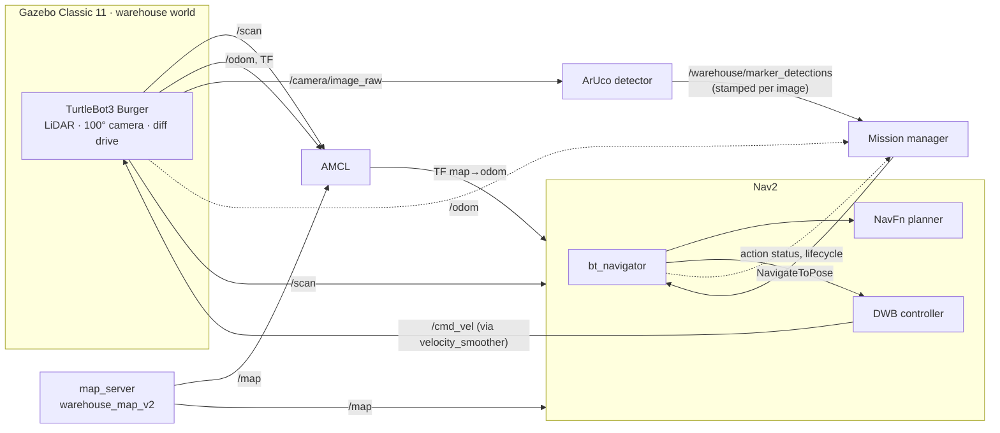

# Autonomous Warehouse Inspection Robot

*ROS 2 Humble · Nav2 · Gazebo Classic 11 · OpenCV ArUco*


A simulated TurtleBot3 drives a five-step inspection route through a warehouse. It visits four stations,
confirms each one by reading its ArUco marker, and returns to its start. A supervising mission manager decides
when a station counts as visited: Nav2 reports the goal reached, the robot is physically settled, and the
camera has seen the right marker in an image taken after it stopped.

**v1.1 results** (simulation; three missions per mode; details in the
[Phase 7 report](docs/validation/phase7_integrated_validation/REPORT.md)):

| | v1.0.1 (diagnostic run) | v1.1 headless | v1.1 graphical |
|---|---|---|---|
| Mission completed, exit 0 | final step not observed (simulator crash) | 3/3 | 3/3 |
| Stations verified | — | 15/15 | 15/15 |
| Station position error (true stop vs intended) | 0.18–0.50 m | max 0.099–0.127 m | max 0.099–0.117 m |
| Settled heading error, mean | — | 3.3–3.9° | 3.6–4.7° |
| Nav2 failures from acknowledgement timeouts / recovery behaviours | 19 / Spin, Wait, BackUp | 0 / 0 | 0 / 0 |
| Camera frames delivered | 0.6 Hz sim | 4.7–7.2 Hz sim | 2.6–4.2 Hz sim |
| Marker evidence | any ID after arrival | image captured after settling, ≤ 0.2 s old | ≤ 0.4 s old |
| Robot settled before verification and at mission end | not checked | yes | yes |

*Simulation only; not validated on hardware and not safety-certified. "Inventory scan" and "charging dock" are
station names: the robot reads a marker there, it does not scan inventory or charge. See
[Limitations](#limitations).*

---

## Demo


https://github.com/user-attachments/assets/dd67f2da-6fb0-4903-81f8-b93f97a8f34c

These were recorded at v1.0, before the camera change and the supervised mission manager; the world, route and
markers are the same. A v1.1 recording can be made by following
[`docs/release/DEMO_RECORDING.md`](docs/release/DEMO_RECORDING.md). A successful v1.1 mission ends with:

```
FINAL CHECK: robot stationary and Nav2 idle.
WAREHOUSE MISSION COMPLETE: ALL TASKS SUCCEEDED
Total mission steps: 5
Successful tasks: 5
Failed tasks: 0
Unattempted tasks: 0
```

---

## How it works



| Subsystem | What it does |
|---|---|
| **Mapping and localization** | A Cartographer map (`warehouse_map_v2`) from a scripted coverage drive; never-observed cells are kept unknown. AMCL localizes against it. Station goals were **surveyed in the map frame** by placing the robot at each intended pose and recording its localization estimate. |
| **Global planning** | NavFn with `allow_unknown: false`, replanning every second inside Nav2's replanning-and-recovery behaviour tree. The tree's global costmap clears keep the static map. |
| **Motion control** | DWB, tuned through controlled experiments: alignment look-ahead 0.325 m (fewer corrective swings), heading tolerance 0.07 rad (settled heading about 4°). |
| **Station recognition** | A 100° pinhole camera (320×240) and OpenCV ArUco (DICT_5X5_50). The detector publishes one timestamped `vision_msgs/Detection2DArray` per image. |
| **Mission supervision** | A timer-driven state machine. Before each goal: Nav2 active and idle, and the robot stationary. After success: the robot must settle on fresh odometry, and the expected marker must appear in an image captured after settling. Before reporting success: a final settled-and-idle check. Bounded timeouts everywhere, a sim-clock stall watchdog, no blind goal resends, late goals cancelled, and signals handled as a flag with bounded cleanup. |

Exit codes: 0 all succeeded · 1 failures or unconfirmed completion · 2 halted · 3 not started · 130 interrupted.

Full node, topic, action and TF reference, the mission state machine and the v1.1 parameter set:
[`docs/ARCHITECTURE.md`](docs/ARCHITECTURE.md).

---

## Engineering method

v1.0.1 completed missions but stopped 0.18–0.50 m from the intended positions. A diagnostic investigation
traced the problems to their causes, and each was fixed in a separate, measured phase. Every phase had a
pre-registered question, controlled experiments, validation missions with recorded rosbags, and a report that
states its limitations. Selected results:

| Phase | Finding → change | Measured effect |
|---|---|---|
| 1 | Goals measured in the world frame were sent as map goals (≈2° rotation) → frame correction | mean position error 0.35 → 0.07 m |
| 2a/2b | The map loaded never-observed space as free → correct classification, then a new SLAM map and surveyed goals | first plans over unknown cells 25.9 m → 0.08 m |
| 3 | Nav2's 20 ms acknowledgement budget caused orphaned goals and recoveries → 200 ms, plus a keep-static behaviour tree | acknowledgement timeouts 19 → 0; recoveries 9 → 0 |
| 4 | The 182° wide-angle camera rendered six views per frame in software → 100° pinhole camera | camera frames 6× faster; verification latency 1.35 → 0.23 s |
| 4b | The GUI's CPU cost → optional headless mode | RTF 0.76 → 0.87 |
| 5 | DWB corrective swings; heading limited by the tolerance → alignment look-ahead and tolerance | total rotation −14%; settled heading 6–9° → about 4° |
| 6 | Arrival was taken as completion; the marker message was unstamped → settling, fresh stamped evidence, final check; signal and shutdown fixes | no verification on stale or moving evidence in fault tests; project processes exit cleanly |
| 7 | Integrated validation, 3 headless + 3 graphical missions | 6/6 completed; table above |

Reports for every phase: [`docs/validation/README.md`](docs/validation/README.md).

---

## Quickstart

Tested on Ubuntu 22.04 (WSL2) with ROS 2 Humble and Gazebo Classic 11.

```bash
# ROS 2 Humble (desktop), then:
sudo apt install ros-humble-navigation2 ros-humble-nav2-bringup ros-humble-gazebo-ros-pkgs \
  ros-humble-turtlebot3-gazebo ros-humble-turtlebot3-msgs ros-humble-dynamixel-sdk \
  ros-humble-xacro ros-humble-cv-bridge ros-humble-vision-msgs python3-opencv python3-pytest

git clone https://github.com/Sara-Esm/ros2-autonomous-warehouse-navigation.git ~/projects/warehouse_ws
cd ~/projects/warehouse_ws
source /opt/ros/humble/setup.bash
rosdep install --from-paths src --ignore-src -y   # optional: verifies dependencies
colcon build
```

The vendored `src/turtlebot3` also builds ROBOTIS's real-robot driver, hence `dynamixel-sdk`.

**Run the mission (two terminals):**

```bash
# Terminal 1: Gazebo + Nav2 + RViz + ArUco detector (Nav2 is up after about 60 s)
cd ~/projects/warehouse_ws && source /opt/ros/humble/setup.bash && source install/setup.bash
export TURTLEBOT3_MODEL=burger_cam
ros2 launch warehouse_bringup warehouse_robot_system_camera.launch.py
#   headless: add  gui:=false use_rviz:=false debug_window:=false

# Terminal 2: the mission waits for Nav2 by itself, then exits with its status code
cd ~/projects/warehouse_ws && source /opt/ros/humble/setup.bash && source install/setup.bash
ros2 run warehouse_bringup warehouse_autonomy --ros-args -p use_sim_time:=true
echo "exit code: $?"
```

Ctrl+C in Terminal 2 cancels the active goal and exits with 130. Stopping from a script, and why
`ros2 launch` should be started through `scripts/sigdfl_exec.py` there:
[`docs/operation.md`](docs/operation.md#stopping-the-mission).

**Run the automated tests** (no Gazebo needed, about 7 minutes):

```bash
colcon test --packages-select warehouse_bringup warehouse_perception warehouse_gazebo
colcon test-result --verbose      # v1.1: 108 tests, 105 passed, 3 skipped (copyright, by design)
```

The tests run the real mission node against a mock Nav2. They cover navigation success, abort, retry,
rejection, lost and late responses, settling and stale or missing odometry, stale, delayed, wrong or legacy-only
marker evidence, clock stalls, the final check, and SIGINT/SIGTERM in every mission phase. They also check
configuration, launch wiring and the map. CI runs them, then a full Gazebo mission, on every pull request
to `main`.

**Run a recorded trial** (starts and stops the simulation; the tracked tree must be clean):

```bash
scripts/run_mission_trial.sh 13          # writes audit_logs/*_trial13.*
```

---

## Limitations

1. **Simulation only.** Six missions on one WSL2 machine, plus CI. They show repeatable completion under
   these conditions, not a reliability rate. There was no hardware, no other worlds and no other start poses.
2. **No independent safety layer.** Stationarity and stops are judged from the same odometry the controller
   uses. Nothing here is safety-certified.
3. **Clearance.** The tightest point is a pinch on the Inventory→Dispatch leg. Footprint clearance there was
   0.25–0.32 m in the v1.1 missions, 0.21 m in one Phase 5 run, and 0.25–0.27 m in the pre-Phase 5 baselines.
   Part of the variation comes from where the global plan is placed. A regression from the Phase 5 controller
   change is measurable in tracking deviation, but its total size is unresolved. The original clearance
   criterion is not shown to be met.
4. **Departure delay.** At one departure that needs a ~180° turn (Loading Zone), DWB sometimes hesitates. Its
   costs for turning and standing still differ by about 0.4%. This was seen in 4 of 7 runs with the v1.1
   controller (2–9 s; once ended by Nav2's progress checker), never in 3 earlier baselines, and the mission
   completed every time. Cause not established; `RotationShimController` is the candidate fix.
5. **Unknown space.** NavFn will not *plan* through unknown cells, but the controller's local costmap does not
   represent unknown space. Measured against 1.8 s global-costmap snapshots, the robot crossed 2.4–4.3 m of
   then-unknown cells per mission, almost all of it free in the next snapshot. The open centre and far east
   bays are unmapped (outside the route).
6. **Performance.** Rendering is software-only on this WSL2 host: RTF is 0.65–0.88 and the camera 2.6–7.2 Hz
   sim, depending on mode. Nav2's control loops are wall-paced, so their sim-time rate depends on RTF.
7. **Marker presence, not pose.** Verification checks the expected ID in a fresh image; there is no marker
   pose or camera calibration. The 100° camera fails to see the marker only when the robot stops at least
   0.125 m closer to it than intended; stops reached up to 0.053 m past the goal.
8. **Fixed mission and launch timers.** Hard-coded waypoints, one robot. Nav2 and the detector start on timers;
   the mission waits for real readiness.
9. **Shutdown.** Nav2's composed container (Humble) ignores SIGINT and SIGTERM. `ros2 launch` force-kills it,
   and everything is down about 11 s after the signal. In graphical mode, Gazebo's wrapper and RViz also exit
   abnormally during teardown (upstream).

## Future work

- `RotationShimController` (or similar) for large initial heading errors, validated against the departure delay.
- Planner-side clearance: global inflation cost and NavFn path placement at the south pinch.
- Execution-time unknown-space awareness: closed-loop evaluation of local tracking with `inf_is_valid`. Strict
  tracking was shown to block DWB.
- A hardware run, marker pose estimation, and an event-driven launch.

## Documentation

- [`docs/ARCHITECTURE.md`](docs/ARCHITECTURE.md): nodes, topics, actions, TF, state machine, v1.1 parameters
- [`docs/validation/README.md`](docs/validation/README.md): every phase report and per-phase results
- [`docs/release/RELEASE_NOTES_v1.1.md`](docs/release/RELEASE_NOTES_v1.1.md) and
  [`docs/release/INTEGRATION_PLAN.md`](docs/release/INTEGRATION_PLAN.md)
- [`docs/diagnostics/REPORT.md`](docs/diagnostics/REPORT.md): the v1.0.1 diagnostic investigation
- [`docs/operation.md`](docs/operation.md): package layout, parameters, stopping the mission
- [`docs/history_v1.0.md`](docs/history_v1.0.md) and [`docs/trial_results.md`](docs/trial_results.md):
  the v1.0 trials and supervision story

## Credits and upstream dependencies

- [ROS 2 Humble](https://docs.ros.org/en/humble/), [Nav2](https://docs.nav2.org/) (AMCL, NavFn, DWB,
  behaviour-tree navigator, lifecycle manager) and [Gazebo Classic 11](https://classic.gazebosim.org/) with
  `gazebo_ros_pkgs`.
- [ROBOTIS TurtleBot3](https://github.com/ROBOTIS-GIT/turtlebot3), vendored in `src/turtlebot3` (Apache 2.0).
  The `burger_cam` Nav2 parameters in it were tuned for this project, and the camera model was derived from its
  `turtlebot3_burger_cam`.
- [AWS RoboMaker Small Warehouse World](https://github.com/aws-robotics/aws-robomaker-small-warehouse-world)
  (MIT-0): warehouse models and world.
- [OpenCV](https://opencv.org/) ArUco (`cv2.aruco`), `cv_bridge` and `vision_msgs`.

## Author

**Sara Esmaeili**: Robotics Software Engineer. GitHub: [@Sara-Esm](https://github.com/Sara-Esm)

## License

MIT; see [LICENSE](LICENSE). Bundled third-party content (TurtleBot3, AWS RoboMaker warehouse models) keeps its
own licenses.
