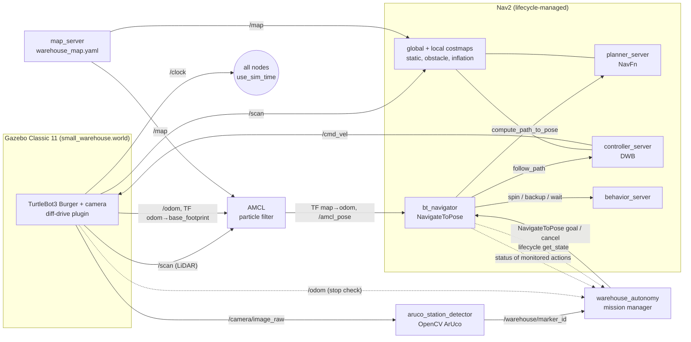
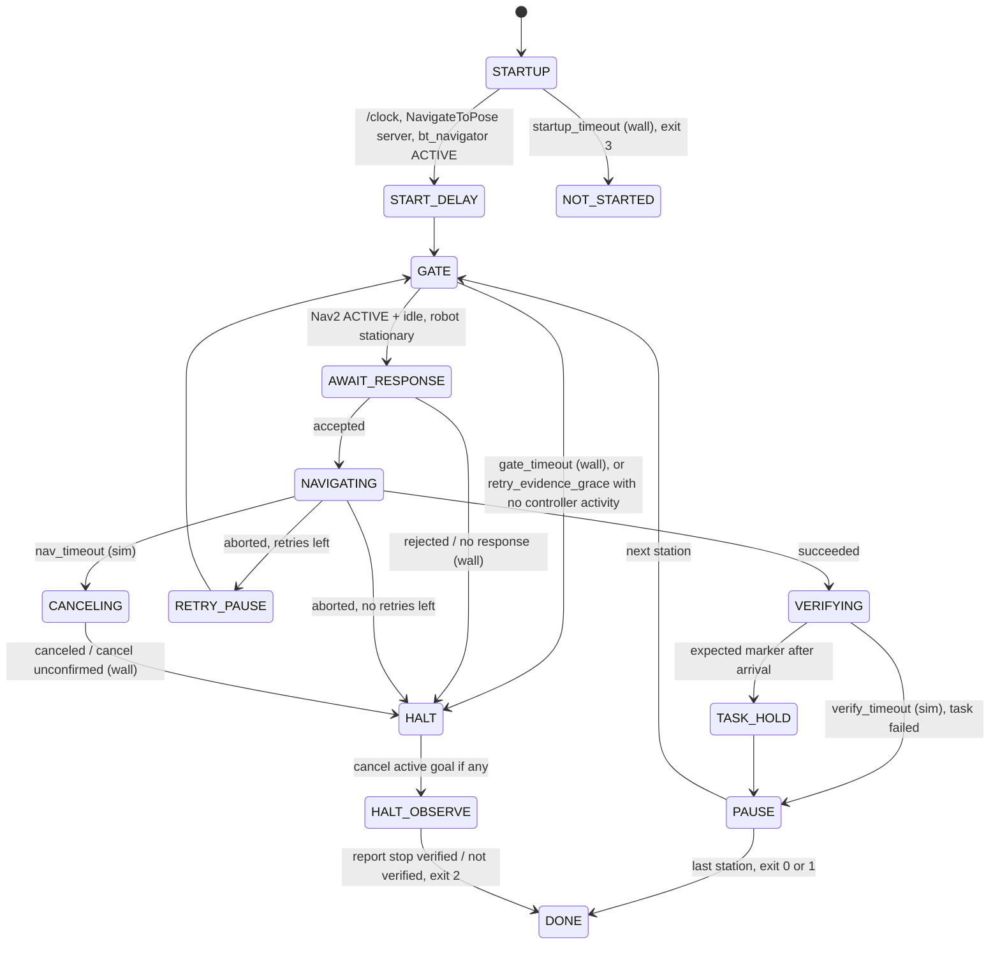

# Autonomous Warehouse Inspection Robot

*ROS 2 Humble · Nav2 · Gazebo Classic 11 · OpenCV ArUco*


A simulated TurtleBot3 visits four warehouse stations, confirms each one by reading its
ArUco marker, and returns to its charging dock. A mission manager checks Nav2 action status and recent
odometry before sending each goal.

- **Supervised retries.** A failed `NavigateToPose` does not mean Nav2 is idle. In Trial 08, a
  `follow_path` controller goal stayed active for about 64 s after the outer goal aborted.
  Before retrying, the manager waits for the observed controller goal to clear, checks the
  configured actions for activity, and requires fresh odometry showing a stationary hold.
- **Sim-time aware.** Mission timing runs on simulation time and watchdogs on wall time, so
  a stalled `/clock` is detected instead of hiding a hung server.
- **Clear reporting.** Every run ends with counts of succeeded, failed and unattempted
  tasks, and a distinct exit code.
- **Tested.** 54 automated tests: 51 passed, 3 skipped. 37 of them exercise the real
  mission node against a mock Nav2. A separate CI job runs the full mission in Gazebo.

**Results:** Local Trials 10 and 12 each verified all five visits. Trial 12 recovered from
a navigation abort after a 116-second wait before retrying. Two linked CI runs
([45570293516](https://github.com/Sara-Esm/ros2-autonomous-warehouse-navigation/actions/runs/45570293516), [45579301270](https://github.com/Sara-Esm/ros2-autonomous-warehouse-navigation/actions/runs/45579301270)) also verified all five
visits. [Full trial log →](docs/trial_results.md)

Five successful steps show that navigation completed and that each station's marker *identity* was
confirmed. They do not show precise physical positioning. In a later diagnostic experiment, the robot
stopped 0.18–0.50 m from the intended station positions while still passing every marker check
([diagnostic report →](docs/diagnostics/REPORT.md)).

*Simulation only. See [Limitations](#limitations).*

---

## Demo


https://github.com/user-attachments/assets/dd67f2da-6fb0-4903-81f8-b93f97a8f34c

The screenshot and video were recorded before the supervised mission manager and the Nav2
tuning. The world, robot, stations and markers are the same. The current mission ends like
this (Trial 12, exit code 0):

```
WAREHOUSE MISSION COMPLETE: ALL TASKS SUCCEEDED
Total mission steps: 5
Successful tasks: 5
Failed tasks: 0
Unattempted tasks: 0
```

---

## Quickstart

Tested on Ubuntu 22.04 (WSL2) with ROS 2 Humble and Gazebo Classic 11.

```bash
# ROS 2 Humble desktop, then:
sudo apt install ros-humble-navigation2 ros-humble-nav2-bringup ros-humble-gazebo-ros-pkgs \
  ros-humble-turtlebot3-gazebo ros-humble-turtlebot3-msgs ros-humble-dynamixel-sdk \
  ros-humble-xacro ros-humble-cv-bridge python3-opencv python3-pytest

git clone https://github.com/Sara-Esm/ros2-autonomous-warehouse-navigation.git ~/projects/warehouse_ws
cd ~/projects/warehouse_ws
source /opt/ros/humble/setup.bash
rosdep install --from-paths src --ignore-src -y   # optional: verifies dependencies
colcon build
```

The vendored `src/turtlebot3` builds ROBOTIS's packages, including the real-robot driver
(hence `dynamixel-sdk`).

**Run the mission (two terminals):**

```bash
# Terminal 1: Gazebo + Nav2 + RViz + ArUco detector (Nav2 is up after about 60 s)
cd ~/projects/warehouse_ws
source /opt/ros/humble/setup.bash
source install/setup.bash
export TURTLEBOT3_MODEL=burger_cam
ros2 launch warehouse_bringup warehouse_robot_system_camera.launch.py

# Terminal 2: the mission waits for Nav2 by itself, then exits with its status code
cd ~/projects/warehouse_ws
source /opt/ros/humble/setup.bash
source install/setup.bash
ros2 run warehouse_bringup warehouse_autonomy --ros-args -p use_sim_time:=true
echo "exit code: $?"
```

Adding `gui:=false` to the launch runs Gazebo without its client window. That frees CPU (the camera reached
about 8 Hz instead of 5.7 Hz on the bench), but it has not been validated with a full mission (see Limitations).

Ctrl+C in Terminal 2 cancels the active goal and exits with code 130. To stop it from a
script, see [Stopping the mission](docs/operation.md#stopping-the-mission).

**Run the automated tests** (no Gazebo needed, about 3 minutes):

```bash
colcon test --packages-select warehouse_bringup warehouse_perception warehouse_gazebo
colcon test-result --verbose
```

**Run a recorded trial** (starts and stops the simulation itself; the tracked tree must be clean):

```bash
scripts/run_mission_trial.sh 13          # next unused number; writes audit_logs/*_trial13.*
scripts/trial_metrics.py --all           # compare with earlier trials
```

<details>
<summary>Rebuild the map (optional; the map is included)</summary>

Needs `ros-humble-cartographer-ros`.

```bash
ros2 launch warehouse_bringup warehouse_simulation_camera.launch.py
ros2 launch turtlebot3_cartographer cartographer.launch.py use_sim_time:=true
ros2 run turtlebot3_teleop teleop_keyboard
ros2 run nav2_map_server map_saver_cli -f src/warehouse_bringup/maps/warehouse_map
```

</details>

---

## How it works

| Step | Station | Intended approach pose (world frame, evaluation reference) | Nav2 goal (surveyed, `warehouse_map_v2` frame) | Verified by |
|---|---|---|---|---|
| 1 | Home Charging Dock | (-3.678, 9.300), 90° | (-3.543, 9.296), 90.59° | ArUco ID 0 |
| 2 | Loading Zone | (1.803, 9.300), 90° | (1.933, 9.220), 88.93° | ArUco ID 1 |
| 3 | Inventory Scan Station | (1.801, -9.000), -90° | (1.693, -8.985), -90.30° | ArUco ID 2 |
| 4 | Dispatch Zone | (-3.630, -9.300), -90° | (-3.704, -9.282), -91.24° | ArUco ID 3 |
| 5 | Return to Home Charging Dock | same as step 1 | same as step 1 | ArUco ID 0 |

The robot spawns at the origin. For each step the mission manager sends a `NavigateToPose`
goal. On arrival it waits up to 15 s (simulation time) for the expected marker ID, and only
detections received after arrival count. A failed marker check fails that task and the
mission continues. An aborted navigation is retried once, after the supervisor sees the
controller finish. A cancellation, or a failed retry, halts the mission. The markers are
0.28 m DICT_5X5_50 tags standing about 0.3 m in front of the warehouse walls, 0.67–0.97 m in front of the goal poses.

The station goals are approach poses about 0.67–0.97 m in front of the markers, not the marker positions.
They were measured in Gazebo's *world* frame, but Nav2 executes them in the SLAM *map* frame. The SLAM map's
orientation is arbitrary; that is not a defect. Up to v1.0.1 the world-frame poses were supplied directly as
map goals. The diagnostic experiment found a relative rotation of about 2.05° and a translation between the
frames, which explains most of the measured station positioning discrepancies (see below).

Phase 1 corrected this with a calibration measured from simulator ground truth (git `69befa2`). Since
Phase 2b, the robot uses a new Cartographer map (`warehouse_map_v2`, made by a scripted coverage drive), and
[`stations.py`](src/warehouse_bringup/warehouse_bringup/stations.py) holds goals **surveyed directly in that
map frame**. The robot was positioned at each intended approach pose and its validated localization estimate
was recorded, which is how a real deployment would set station goals. Ground truth is used only to evaluate
accuracy, not to generate goals.

### System architecture

The diagram shows the data flow: Gazebo publishes LiDAR, odometry, camera images and the
simulation clock; AMCL and Nav2 navigate from the LiDAR and the saved map; the ArUco detector
publishes marker IDs; the mission manager sends goals and passively watches Nav2 and odometry.



Dotted lines are the mission manager's passive supervision inputs. It never publishes
velocity commands.

### Mission state machine

Each goal passes through a readiness gate, a bounded wait for Nav2's response, navigation
and marker verification. A missed marker fails that visit and the mission continues.
An exhausted navigation retry halts the mission and starts a stop check.



A clock-stall watchdog can halt the mission from any active state.

### What the supervisor checks

- **Before every goal:** action-server discovery, a fresh ACTIVE response from
  `bt_navigator`, the identity of the monitored status publishers, no active goal reported by
  the monitored actions, and a stationary hold across odometry samples. Before retrying an
  abort, it also requires evidence that `follow_path` was active during this attempt and has
  since cleared.
- **Every wait is bounded.** Mission waits run on simulation time. Communication watchdogs
  (goal response, cancel, `/clock` stall) run on a steady wall clock.
- **Unresolved goals are tracked.** A late acceptance after a response timeout is
  cancelled, and the manager waits a bounded time for its result. The same cleanup runs on
  Ctrl+C or SIGTERM.
- **Exit codes:** 0 all succeeded, 1 finished with failed tasks, 2 halted, 3 never started,
  130 interrupted. After a halt the node prints `ROBOT STOP VERIFIED (odometry)` or
  `ROBOT STOP NOT VERIFIED` with the reason.

These are observations from the same software stack, not an independent safety channel.
Interfaces, parameters and design notes are in [`docs/operation.md`](docs/operation.md).

---

## The story: from Trial 08 to Trial 12

**Trial 08 exposed the problem.** On the final return home, the outer `NavigateToPose`
aborted. Nav2's spin, backup and wait behaviors kept running for about 10 s afterwards, and
a `follow_path` controller goal stayed active for about 64 s. The mission manager of that
time treated the abort as "Nav2 is idle". In a separate fault-injection run with the
controller deactivated, the same manager sent the next goal during Nav2's lifecycle restart
and then waited forever for a response.

**The fix** was to check readiness before each goal and bound the wait. Reported activity
on a monitored action or fresh odometry showing motion keeps the gate closed.

**Trial 12 tested it under stress.** The host was heavily loaded (load average 21) and the
simulation ran at 0.31× real time. At step 1, `bt_navigator` timed out waiting for its own
servers to acknowledge goals, and the outer goal aborted. The orphaned `follow_path` goal
kept driving the robot toward the dock. The gate reported
`Nav2 goals still active: follow_path(1); robot not stationary` and held the retry for
about 116 s (wall clock) until the controller finished and the robot stopped. The retry
then succeeded at once, every later station succeeded first time, and the mission ended
5/5 with exit code 0. **No overlapping goal was sent.**

---

## Testing

**Automated tests** (`colcon test`, no Gazebo): 54 tests, 51 passed, 0 failures, 3 skipped (ament
template copyright checks, which skip themselves because the files have no copyright header).

- **37 mission-manager tests** run the real node against a scriptable mock Nav2 (action
  server, lifecycle service, `follow_path` status, odometry, marker stream) and a fake
  `/clock`, each on its own DDS domain. They cover rejection, aborts with and without retry,
  wrong or missing markers, sim rates of 0.5× and 2×, Nav2 unavailable or inactive,
  lifecycle failure and recovery, lost and late goal responses, result timeouts, a stalled
  clock, retries held while `follow_path` is active or the robot is moving, stop reports,
  and exit codes 0, 1, 2 and 130 (SIGINT, and SIGTERM to the installed executable).
- **3 tracker unit tests** for the Nav2 activity and odometry motion trackers.
- **Perception and assets:** detection of IDs 0–3 and rejection of a DICT_4X4 marker
  (OpenCV 4.5.4 and 4.11); the committed marker textures match the generator pixel for
  pixel.
- **Lint:** `ament_flake8` and `ament_pep257` for all three packages.

The mock tests verify mission logic and supervision only, not physical motion.

**End-to-end trials** use `scripts/run_mission_trial.sh`: a fresh simulation, readiness
checks (`bt_navigator` and `amcl` ACTIVE, `/amcl_pose`, the `map → odom → base_footprint`
TF chain), a real-time-factor measurement, the mission, and saved logs, metadata and
metrics under `audit_logs/`.

**CI** ([`.github/workflows/warehouse-humble.yml`](.github/workflows/warehouse-humble.yml))
runs the test suite and then the same trial script on every pull request to `main`, on an
Xvfb virtual display with software rendering and the Gazebo client and RViz enabled. That is
not the same as a GUI-free run: no client-free configuration has been validated on this code.

---

## Results

Counted from the saved logs by `scripts/trial_metrics.py`.

| Run | Where | Code | Stations | Nav aborts / retries | Real-time factor |
|---|---|---|---|---|---|
| Trial 10 | Local, WSL2 | `3e8e1b7` (Nav2 tuning) | 5/5 | 0 / 0 | 0.67 |
| Trial 12 | Local, WSL2, heavy load | `0998813` (supervised manager) | 5/5, exit 0 | 1 / 1 (recovered) | 0.31 |
| [CI run 45570293516](https://github.com/Sara-Esm/ros2-autonomous-warehouse-navigation/actions/runs/45570293516) | GitHub runner, Xvfb + software GL | `847f31c` | 5/5, exit 0 | 0 / 0 | 0.84 |
| [CI run 45579301270](https://github.com/Sara-Esm/ros2-autonomous-warehouse-navigation/actions/runs/45579301270) | GitHub runner, Xvfb + software GL | `d34a0de` | 5/5, exit 0 | - | - |

All four use the same Nav2 parameter file; for Trial 10 that is established from git
history, since its metadata predates the runner's `nav2_params_sha256` field. Both CI runs tested the current mission code;
`d34a0de` is the tree merged to `main`, and `847f31c` differs from it only in tests and
documentation. The trial script exits with the mission's exit code, and 0 means all five
tasks succeeded. The first CI run's logs are kept in
[`audit_logs/ci_run_45570293516/`](audit_logs/ci_run_45570293516/PROVENANCE.md). The second
run's logs are only in its GitHub artifact, so its abort and RTF columns are not filled in.

Earlier trials (01–08) record the baseline, a rejected headless experiment, and the failure
that led to the supervision work. Every trial, including unsuccessful and interrupted ones,
is listed with notes in [`docs/trial_results.md`](docs/trial_results.md).

### Station positioning (separate diagnostic experiment)

These numbers come from one instrumented diagnostic mission on v1.0.1 (2026-11-25), not from the trials
above. Ground truth is Gazebo's world pose of the robot at the moment the mission logged ARRIVED.

| Station | Distance from intended position | Heading error | Marker verified |
|---|---|---|---|
| Home Charging Dock | 0.50 m | +9.6° | yes |
| Loading Zone | 0.40 m | +9.5° | yes |
| Inventory Scan Station | 0.18 m | +8.9° | yes |
| Dispatch Zone | 0.32 m | −2.4° | yes |

A single rigid map-to-world transform (2.05° rotation plus a translation), fitted only to map geometry,
predicts these distances to within 0.03–0.11 m. The rigid transform explains most, not all, of the
discrepancy. Residual errors remain:

- systematic regional shifts of about 5 cm or less;
- residual position error with a median of 8.8 cm, a 95th percentile of 19.5 cm and a maximum of 25.0 cm;
- a worst regional median of 16.2 cm.

In this diagnostic experiment:

- Four station visits completed and passed ArUco identity verification.
- The fifth visit was incomplete because Gazebo crashed. Instrumentation interference is suspected, not confirmed.
- Motion after a successful final completion remains unresolved.
- The BT client's runtime clock was inferred rather than directly verified.
- Action-acknowledgement latency was not measured.

These results are separate from the successful historical missions in the table above. Methods,
measurements, limitations and an untested improvement backlog are in
[`docs/diagnostics/REPORT.md`](docs/diagnostics/REPORT.md).

### Station positioning after the frame correction (Phase 1 validation)

One validation mission on `feat/station-frame-correction`. Only the station goals changed; the Nav2
parameters, map and markers are unchanged. The run used lighter instrumentation than the diagnostic
experiment.

| Station | v1.0.1 diagnostic | Phase 1 position | Phase 1 heading | Marker verified |
|---|---|---|---|---|
| Home Charging Dock | 0.50 m, +9.6° | **0.04 m** | +6.9° | yes |
| Loading Zone | 0.40 m, +9.5° | **0.08 m** | −10.4° | yes |
| Inventory Scan Station | 0.18 m, +8.9° | **0.05 m** | +8.0° | yes |
| Dispatch Zone | 0.32 m, −2.4° | **0.10 m** | −7.0° | yes |
| Return to Home Charging Dock | not reached | **0.10 m** | −7.7° | yes |

Results:

- 5/5 tasks succeeded, exit code 0, no simulator crash.
- The mean position error on the four comparable stations fell from 0.35 m to 0.07 m.
- The mean heading bias fell from +6.4° to −0.6°. The heading magnitude stays at 7–10° because the goal
  checker accepts headings at the edge of its unchanged 8.6° tolerance.
- A residual turning motion settled 1.26 s after the final NavigateToPose success, which came before the
  MISSION COMPLETE report. The robot was then stationary (0.0 mm displacement, no velocity commands) for the
  remainder of the observation window, including 60 s after the mission report.
- The run was not error-free. Spin, Wait and BackUp recoveries still occurred, and each coincided with an
  action-acknowledgement timeout (16 in total), which belongs to a later phase. The detector and RViz
  exited with errors at teardown.

Details: [`docs/validation/phase1_station_frames/REPORT.md`](docs/validation/phase1_station_frames/REPORT.md).

### Unknown space after the map-classification correction (Phase 2a validation)

One validation mission on `feat/map-unknown-space`, compared with the Phase 1 mission. The only robot change
is the map's `free_thresh`, from 0.25 to 0.01. The map's unknown cells (60.1% of the image: unobserved or low-confidence) now load as
**unknown** instead of free: 3,772 occupied, 51,911 free and 83,919 unknown cells, verified with the real
`nav2_map_server` in the local and CI environments and regression-tested. The threshold is empirical: the
installed builds do not decode the PGM by the textbook formula, so 0.19 would have changed nothing.

The planner still **may** cross unknown space (`allow_unknown: true`), but now pays heavily for it: crossing
1 m of unknown costs as much as about 4–6 m of free travel. Prohibiting unknown space is deferred to a
re-mapping phase, because the current map leaves the north and south stations connected through observed
space only via a single unknown cell.

| Measure | Phase 1 | Phase 2a |
|---|---|---|
| Mission | 5/5, exit 0 | 5/5, exit 0 |
| Station position error, stations 1–4 mean / all five mean / max | 0.069 / 0.076 / 0.102 m | 0.057 / 0.055 / 0.103 m |
| First plans over unknown cells (unobserved or low-confidence) | 25.9 m | 5.7 m |
| Driven over unknown cells (unobserved or low-confidence) | 25.8 m (41%) | 15.8 m (23%), of which 5.1 m on cells still unknown in the live costmap |
| Return-home leg | 18.6 m | 24.7 m |
| Minimum clearance to true geometry | 0.32 m | 0.28 m (central-block corner) |
| Route changes > 0.5 m during a leg | 0 | 2 (one leg) |

This is a reduction, not a prevention, of unknown-space traversal. The robot also now takes longer, closer
routes through the one observed corridor. Details:
[`docs/validation/phase2a_map_unknown_space/REPORT.md`](docs/validation/phase2a_map_unknown_space/REPORT.md).

### Re-mapped warehouse and surveyed goals (Phase 2b validation)

One validation mission on `feat/slam-remap`. Changes:

- A new Cartographer map from a scripted, collision-aware coverage drive (two attempts; the second added
  targeted passes of the west aisle).
- Station goals surveyed in that map's frame.
- `allow_unknown: false`.

Camera, controller, timeouts and goal tolerances are unchanged.

| Measure | Phase 1 | Phase 2a | Phase 2b |
|---|---|---|---|
| Mission / markers | 5/5, exit 0 / 5 | 5/5, exit 0 / 5 | 5/5, exit 0 / 5 |
| Station position error, stations 1–4 mean / max | 0.069 / 0.102 m | 0.057 / 0.103 m | 0.078 / 0.116 m |
| First plans over unknown cells of the map in use | 25.9 m | 5.7 m | 0.08 m |
| Return-home leg | 18.6 m | 24.7 m | 19.6 m |
| Minimum clearance to true geometry | 0.32 m | 0.28 m | 0.36 m |
| Route changes > 0.5 m during a leg | 0 | 2 | 1 (0.77 m) |
| Recoveries (Spin / Wait / BackUp) | 1 / 1 / 1 | 1 / 1 / 1 | 3 / 3 / 3 |

Results:

- Every leg now plans through known space. Two poses clip a thin low-confidence streak, an interpolation artifact.
- The return detour and the narrow central-corner passage are gone.
- Recoveries tripled. All of them followed action-acknowledgement timeouts.
- One new failure mode appeared: a planning failure right after a full costmap clear, which a timeout had
  triggered. *Hypothesis, not established:* the stricter unknown-space policy exposes such transient costmap
  states. It is the next phase's topic.

Details: [`docs/validation/phase2b_slam_remap/REPORT.md`](docs/validation/phase2b_slam_remap/REPORT.md).

### Timing and synchronization (Phase 3 validation)

One validation mission on `feat/timing-sync`. Changes:

- The behaviour tree's acknowledgement and service budget (`default_server_timeout`) goes from 20 to 200 ms.
  Measured acknowledgement latency was usually about 4 ms, but up to 86 ms.
- The velocity smoother now runs on simulation time; this had no measurable effect on its output.
- A copy of Nav2's behaviour tree whose global costmap clears keep the static map. This avoids a clear/plan
  race reproduced offline; it was not exercised in the mission.

| Measure | Phase 2b | Phase 3 |
|---|---|---|
| Mission / markers | 5/5, exit 0 / 5 | 5/5, exit 0 / 5 |
| Action-acknowledgement timeouts | 19 | 0 |
| Recoveries (Spin / Wait / BackUp) | 3 / 3 / 3 | 0 / 0 / 0 |
| Orphaned late-accepted goals | 15 | 0 |
| Mission time | 591 s | 509 s |
| Station position error, max | 0.116 m | 0.119 m |
| Minimum clearance to true geometry | 0.36 m | 0.31 m (same south pinch) |

Details: [`docs/validation/phase3_timing_sync/REPORT.md`](docs/validation/phase3_timing_sync/REPORT.md).

### Camera performance (Phase 4 validation)

The TurtleBot3 camera model used a 182° `wideanglecamera`. That sensor renders six views per frame and remaps
them, and this machine renders in software, so it delivered about 1 Hz instead of its configured 30 Hz. The
robot now uses a project copy of the model with a 100° pinhole camera. The resolution, rate, topics and
everything else are unchanged. On the bench, the marker was detected in every frame at all four stations, at
44 poses within ±0.12 m and ±11.5° of the goal. A wider sweep of 300 poses within ±0.25 m found no wrong IDs.
Detection failed only when the robot was at least 0.125 m closer to the marker than intended, combined with
lateral and heading offsets. All 25 real stops so far have been short of the goal, never closer to the marker.

| Measure | Phase 3 | Phase 4 |
|---|---|---|
| Mission / markers | 5/5, exit 0 / 5 | 5/5, exit 0 / 5 |
| Camera frames delivered and processed by the detector | 0.69 Hz sim | 4.16 Hz sim (6.0×) |
| Frame age, median | 1.43 s sim | 0.24 s sim |
| Arrival to marker verification, mean | 1.35 s | 0.23 s |
| Real-time factor | 0.71 | 0.76 |
| Memory used, median | 2,427 MiB | 2,175 MiB |
| Timeouts / recoveries | 0 / 0 | 0 / 0 |
| Station position error, max | 0.119 m | 0.111 m |

Details: [`docs/validation/phase4_perception_performance/REPORT.md`](docs/validation/phase4_perception_performance/REPORT.md).

---

## Limitations

1. **Simulation only; reliability rate unmeasured.** Everything ran in Gazebo, on one WSL2
   machine and GitHub-hosted runners. The runs above demonstrate completion under the tested
   conditions; they do not measure a reliability rate. Nothing was tested across worlds or
   start poses.
2. **No independent safety layer.** Stop verification reads the same odometry the
   controller uses. A real robot would need a safety-rated stop path.
3. **Map and frames.** Since Phase 2b the robot uses `warehouse_map_v2` (42.4% unknown, against 60.1%
   for the preserved original). NavFn does not plan through cells that are unknown in the global costmap at
   planning time (`allow_unknown: false`). That is a planning rule, not a guarantee about motion: the
   controller's local costmap does not represent unknown space. Measured against 1.5 s global-costmap
   snapshots, the robot centre still crossed about 3.3 m of then-unknown cells per mission. About 90% of that
   was free in the next snapshot ([Phase 4 report, §8](docs/validation/phase4_perception_performance/REPORT.md)). The large
   open centre of the floor and the far east bays remain unmapped; they are outside the operating area. In
   maps saved by `map_saver`, the "unknown" value 205 also covers observed but low-confidence cells. The map
   frame differs from Gazebo's world frame by about 0.7°, which is harmless because goals are surveyed in the
   map frame. Some obstacles are only partly visible to a 2D LiDAR.
4. **Simulation performance.** The simulation runs at 0.31–0.76× real time on the
   development machine, and the controller logs warnings that it missed its desired control
   rate. All rendering (camera, Gazebo client, RViz) is done in software on the CPU. The GPU path
   is unavailable on this WSL2 setup, which caps the camera at about 4 Hz during a mission. The two GUI-free runs (Trials 05-06) were faster but much less reliable. They
   predate the Nav2 tuning, so that comparison is confounded and the cause is still unknown;
   every run since has kept the Gazebo client enabled.
5. **Fixed launch delays.** Nav2 starts at t = 40 s and the detector at t = 55 s by timer.
   The mission and trial runner wait on real readiness, but the launch is not event-driven.
6. **Fixed mission.** Waypoints are hard-coded and there is one robot. "Docking" is a
   navigation goal within 0.12 m / 0.15 rad plus a marker check, not precision docking.
7. **Marker presence, not pose.** A station counts as verified when the expected marker ID
   is detected after arrival. There is no marker pose estimation or camera calibration. With the
   182° camera used until Phase 4, verification passed even when the robot stopped 0.5 m from the
   intended spot. The 100° camera is less permissive, but it is still a presence check.
8. **Completion is not tied to a stop check.** The success path reports mission completion
   without checking that the robot is stationary. That check runs only after a halt.

## Next steps

- **Size Nav2's `default_server_timeout` from measurements.** `bt_navigator` gives each server
  20 ms (the Nav2 default) to acknowledge a goal. Every logged run has such timeouts (1–41 per
  run). In Trial 12 they caused the first abort, and in the diagnostic run each one turned into a planner
  or controller failure, including a Spin and a BackUp recovery. The acknowledgement latency
  has not been measured, so a larger value is untested and may not remove all of them
  ([analysis](docs/diagnostics/REPORT.md#4-action-acknowledgement-timeouts-and-recoveries)).
- **Handle signals as a flag.** The signal handler currently raises an exception wherever
  the main thread is. If Ctrl+C or SIGTERM lands exactly as Nav2 accepts a goal, cleanup
  still cancels and exits 130, but reported `ROBOT STOP NOT VERIFIED` in 2 of about 17
  deliberately timed runs. Setting a flag for the main loop to check would close that window.

---

## Documentation

- [`docs/trial_results.md`](docs/trial_results.md): every trial, its metrics and notes
- [`docs/validation/phase1_station_frames/REPORT.md`](docs/validation/phase1_station_frames/REPORT.md),
  [`docs/validation/phase2a_map_unknown_space/REPORT.md`](docs/validation/phase2a_map_unknown_space/REPORT.md),
  [`docs/validation/phase2b_slam_remap/REPORT.md`](docs/validation/phase2b_slam_remap/REPORT.md):
  validation of the station-frame correction, occupancy classification, and re-mapping with surveyed goals
- [`docs/validation/phase3_timing_sync/REPORT.md`](docs/validation/phase3_timing_sync/REPORT.md): timing and
  synchronization (acknowledgement timeout, node clocks, costmap clear/plan race)
- [`docs/validation/phase4_perception_performance/REPORT.md`](docs/validation/phase4_perception_performance/REPORT.md):
  camera bottleneck diagnosis, pinhole camera model, detection under arrival uncertainty
- [`docs/diagnostics/REPORT.md`](docs/diagnostics/REPORT.md): diagnostic investigation of v1.0.1
  (map and frame alignment, localization, planning, control dynamics, ArUco, timing, completion)
- [`docs/operation.md`](docs/operation.md): package layout, interfaces, parameters,
  stopping the mission, engineering challenges
- [`docs/trial_baseline_protocol_v1.md`](docs/trial_baseline_protocol_v1.md): the original
  repeatability protocol
- [`audit_logs/`](audit_logs/): raw launch, mission and metadata logs;
  [`scripts/legacy/`](scripts/legacy/): earlier trial runners

## Credits and upstream dependencies

- [ROS 2 Humble](https://docs.ros.org/en/humble/), [Nav2](https://docs.nav2.org/) (AMCL,
  NavFn, DWB, behavior tree navigator, lifecycle manager) and
  [Gazebo Classic 11](https://classic.gazebosim.org/) with `gazebo_ros_pkgs`.
- [ROBOTIS TurtleBot3](https://github.com/ROBOTIS-GIT/turtlebot3), vendored in `src/turtlebot3`
  (Apache 2.0). The `burger_cam` Nav2 parameters in it were tuned for this project.
- [AWS RoboMaker Small Warehouse World](https://github.com/aws-robotics/aws-robomaker-small-warehouse-world)
  (MIT-0): warehouse models and world.
- [OpenCV](https://opencv.org/) ArUco module (`cv2.aruco`) and `cv_bridge` for marker detection.

## Author

**Sara Esmaeili**: Robotics Software Engineer. GitHub: [@Sara-Esm](https://github.com/Sara-Esm)

## License

MIT; see [LICENSE](LICENSE). Bundled third-party content (TurtleBot3, AWS RoboMaker
warehouse models) keeps its own licenses.
