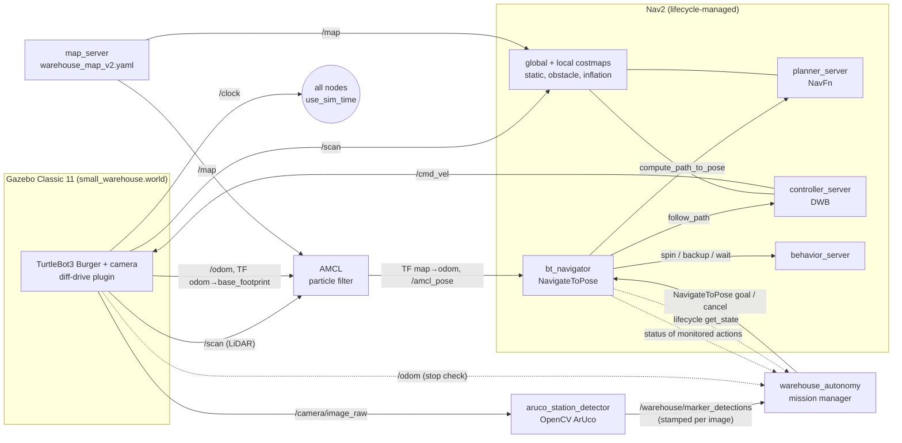

# Architecture

*System architecture, mission flow and supervision. Moved from the README at v1.1 and updated for Phase 6 (settling, stamped marker evidence, final check).*

## Mission and stations

| Step | Station | Intended approach pose (world frame, evaluation reference) | Nav2 goal (surveyed, `warehouse_map_v2` frame) | Verified by |
|---|---|---|---|---|
| 1 | Home Charging Dock | (-3.678, 9.300), 90° | (-3.543, 9.296), 90.59° | ArUco ID 0 |
| 2 | Loading Zone | (1.803, 9.300), 90° | (1.933, 9.220), 88.93° | ArUco ID 1 |
| 3 | Inventory Scan Station | (1.801, -9.000), -90° | (1.693, -8.985), -90.30° | ArUco ID 2 |
| 4 | Dispatch Zone | (-3.630, -9.300), -90° | (-3.704, -9.282), -91.24° | ArUco ID 3 |
| 5 | Return to Home Charging Dock | same as step 1 | same as step 1 | ArUco ID 0 |

The robot spawns at the origin. For each step the mission manager sends a `NavigateToPose`
goal. When Nav2 reports success, the manager first waits for the robot to be **settled**: fresh odometry
below 5 mm/s and 0.01 rad/s for 0.5 s counted from goal success, within 10 s. Then, within 15 s (simulation
time), it needs the expected marker ID from a camera image **captured after settling** and at most 1.0 s old
(Phase 6). A failed marker check fails that task and the
mission continues. An aborted navigation is retried once, after the supervisor sees the
controller finish. A cancellation, or a failed retry, halts the mission. The markers are
0.28 m DICT_5X5_50 tags standing about 0.3 m in front of the warehouse walls, 0.67–0.97 m in front of the goal poses.

The station goals are approach poses about 0.67–0.97 m in front of the markers, not the marker positions.
They were measured in Gazebo's *world* frame, but Nav2 executes them in the SLAM *map* frame. The SLAM map's
orientation is arbitrary; that is not a defect. Up to v1.0.1 the world-frame poses were supplied directly as
map goals. The diagnostic experiment found a relative rotation of about 2.05° and a translation between the
frames, which explains most of the measured station positioning discrepancies (see below).

Phase 1 corrected this with a calibration measured from simulator ground truth (git `69befa2`). Since
Phase 2b, the robot uses a new Cartographer map (`warehouse_map_v2`, made by a scripted coverage drive), and
[`stations.py`](../src/warehouse_bringup/warehouse_bringup/stations.py) holds goals **surveyed directly in that
map frame**. The robot was positioned at each intended approach pose and its validated localization estimate
was recorded, which is how a real deployment would set station goals. Ground truth is used only to evaluate
accuracy, not to generate goals.

## System architecture

The diagram shows the data flow: Gazebo publishes LiDAR, odometry, camera images and the
simulation clock; AMCL and Nav2 navigate from the LiDAR and the saved map; the ArUco detector
publishes marker IDs; the mission manager sends goals and passively watches Nav2 and odometry.

Dotted lines are the mission manager's passive supervision inputs. It never publishes
velocity commands.

### Mission state machine

Each goal passes through a readiness gate, a bounded wait for Nav2's response, navigation
and marker verification. A missed marker fails that visit and the mission continues.
An exhausted navigation retry halts the mission and starts a stop check.

```mermaid
stateDiagram-v2
  [*] --> STARTUP
  STARTUP --> START_DELAY: /clock, NavigateToPose server, bt_navigator ACTIVE
  STARTUP --> NOT_STARTED: startup_timeout (wall), exit 3
  START_DELAY --> GATE
  GATE --> AWAIT_RESPONSE: Nav2 ACTIVE + idle, robot stationary
  GATE --> HALT: gate_timeout (wall), or retry_evidence_grace with no controller activity
  AWAIT_RESPONSE --> NAVIGATING: accepted
  AWAIT_RESPONSE --> HALT: rejected / no response (wall)
  NAVIGATING --> SETTLING: succeeded
  NAVIGATING --> RETRY_PAUSE: aborted, retries left
  NAVIGATING --> HALT: aborted, no retries left
  NAVIGATING --> CANCELING: nav_timeout (sim)
  CANCELING --> HALT: canceled / cancel unconfirmed (wall)
  RETRY_PAUSE --> GATE
  SETTLING --> VERIFYING: settled 0.5 s after success (fresh odometry)
  SETTLING --> PAUSE: settle_timeout (sim), task failed
  VERIFYING --> TASK_HOLD: expected ID in an image captured after settling, <= 1.0 s old
  VERIFYING --> SETTLING: robot moved
  VERIFYING --> PAUSE: verify_timeout or station deadline (sim), task failed
  TASK_HOLD --> PAUSE
  PAUSE --> GATE: next station
  PAUSE --> FINAL_CHECK: last station, all verified
  PAUSE --> DONE: last station with failures, exit 1
  FINAL_CHECK --> DONE: settled and Nav2 idle, exit 0; otherwise exit 1
  HALT --> HALT_OBSERVE: cancel active goal if any
  HALT_OBSERVE --> DONE: report stop verified / not verified, exit 2
```

A clock-stall watchdog can halt the mission from any active state.

### What the supervisor checks

- **Before every goal:** action-server discovery, a fresh ACTIVE response from
  `bt_navigator`, the identity of the monitored status publishers, no active goal reported by
  the monitored actions, and a stationary hold across odometry samples. Before retrying an
  abort, it also requires evidence that `follow_path` was active during this attempt and has
  since cleared.
- **Every wait is bounded.** Mission waits run on simulation time. Communication watchdogs
  (goal response, cancel, `/clock` stall) run on a steady wall clock.
- **Unresolved goals are tracked.** A late acceptance after a response timeout is
  cancelled, and the manager waits a bounded time for its result. The same cleanup runs on
  Ctrl+C or SIGTERM.
- **After every arrival (Phase 6):** goal success is not taken as settling. The robot must show
  fresh, finite odometry below 5 mm/s and 0.01 rad/s, held for 0.5 s sim *after* goal success
  (bounded at 10 s). Only then does the marker check start, and it accepts only camera images
  **captured after settling** (their own acquisition stamp), no older than 1.0 s sim, that
  contain the expected ID while the robot is still stationary. Settling and verification share
  one bounded per-station deadline.
- **Before reporting success:** a final check that the robot is still settled (on fresh
  odometry) and no Nav2 goal is active; otherwise the mission finishes with exit code 1.
- **Signals:** Ctrl+C or SIGTERM only set a flag; the main loop then runs the bounded cleanup.
- **Exit codes:** 0 all succeeded, 1 finished with failed tasks or unconfirmed completion,
  2 halted, 3 never started, 130 interrupted. After a halt the node prints `ROBOT STOP VERIFIED (odometry)` or
  `ROBOT STOP NOT VERIFIED` with the reason.

These are observations from the same software stack, not an independent safety channel.
Interfaces, parameters and design notes are in [`docs/operation.md`](../docs/operation.md).

---

## ROS 2 interfaces

| Node | Package | Publishes | Subscribes / uses |
|---|---|---|---|
| `gazebo` / `gzserver` (+ `gazebo_ros` plugins) | gazebo_ros, turtlebot3_gazebo | `/clock`, `/scan`, `/odom`, TF `odom→base_footprint`, `/camera/image_raw`, `/camera/camera_info` | `/cmd_vel` |
| `robot_state_publisher` | robot_state_publisher | TF (robot links, static) | URDF |
| `map_server`, `amcl` | nav2_map_server, nav2_amcl | `/map`; TF `map→odom`, `/amcl_pose` | `/scan`, TF |
| `planner_server` (NavFn), `controller_server` (DWB), `smoother_server`, `behavior_server`, `bt_navigator`, `velocity_smoother`, `waypoint_follower`, lifecycle managers | Nav2, composed in one container | `/plan`, `/cmd_vel_nav` → `velocity_smoother` → `/cmd_vel`, costmaps, `/evaluation` (only when subscribed) | `/map`, `/scan`, TF, `/odom` |
| `aruco_station_detector` | warehouse_perception | `/warehouse/marker_detections` (`vision_msgs/Detection2DArray`, one per image, source image header); legacy `/warehouse/marker_id` (`Int32`), `/warehouse/marker_detected` (`Bool`) | `/camera/image_raw` |
| `warehouse_autonomy` (mission manager) | warehouse_bringup | logs, exit code | action client `navigate_to_pose`; `/warehouse/marker_detections`; `/odom`; `/<action>/_action/status` of navigate_to_pose, follow_path, compute_path_to_pose, spin, backup, wait, drive_on_heading, assisted_teleop; service `/bt_navigator/get_state`; `/clock` |

**Actions:** `navigate_to_pose` (mission → `bt_navigator`). Inside Nav2, the behaviour tree
`navigate_to_pose_w_replanning_and_recovery_keep_static.xml` calls `compute_path_to_pose`, `follow_path`, `spin`,
`wait`, `backup` and the costmap clear services. Its global clears keep the static layer (Phase 3).

**TF tree:** `map → odom` (AMCL) `→ base_footprint` (Gazebo diff drive; odometry source = world truth) `→ base_link → base_scan, camera_link, wheels` (`robot_state_publisher`).

**Clocks:**

- Every node runs with `use_sim_time`.
- Mission waits use simulation time; communication watchdogs use the steady clock.
- Nav2's control, smoother, behaviour-tree and costmap-update loops are paced by wall time. In simulation time
  their rates scale with 1/RTF (Phase 4b report §5).

## Parameters that define v1.1 behaviour

| Area | Setting | Source |
|---|---|---|
| Map | `warehouse_map_v2` (Cartographer coverage drive), `free_thresh` 0.01 | Phase 2a / 2b |
| Goals | surveyed in the map frame (`stations.py`) | Phase 2b |
| Planner | NavFn, `allow_unknown: false`, tolerance 0.5 m | Phase 2b |
| Behaviour tree | stock replanning/recovery tree, global clears keep static layer; `default_server_timeout` 200 ms | Phase 3 |
| Camera | 100° pinhole, 320×240 (project model `turtlebot3_burger_cam_pinhole`) | Phase 4 |
| Controller | DWB, `PathAlign`/`GoalAlign` `forward_point_distance` 0.325 m, `yaw_goal_tolerance` 0.07 rad, xy tolerance 0.12 m | Phase 5 |
| Mission | settle 5 mm/s, 0.01 rad/s, 0.5 s hold, 10 s timeout; marker evidence ≤ 1.0 s old, captured after settling; final check | Phase 6 |
| Launch options | `gui`, `use_rviz`, `debug_window` (default true; headless = all false) | Phase 4 / 4b |
