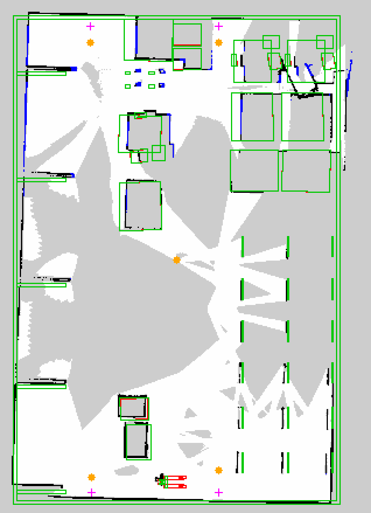
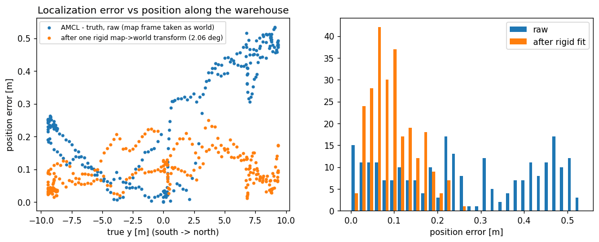
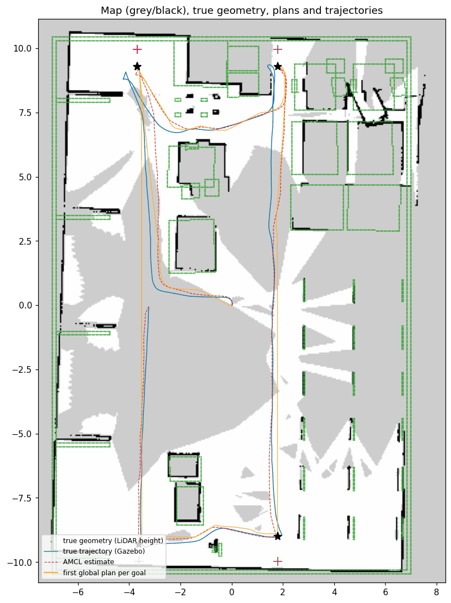
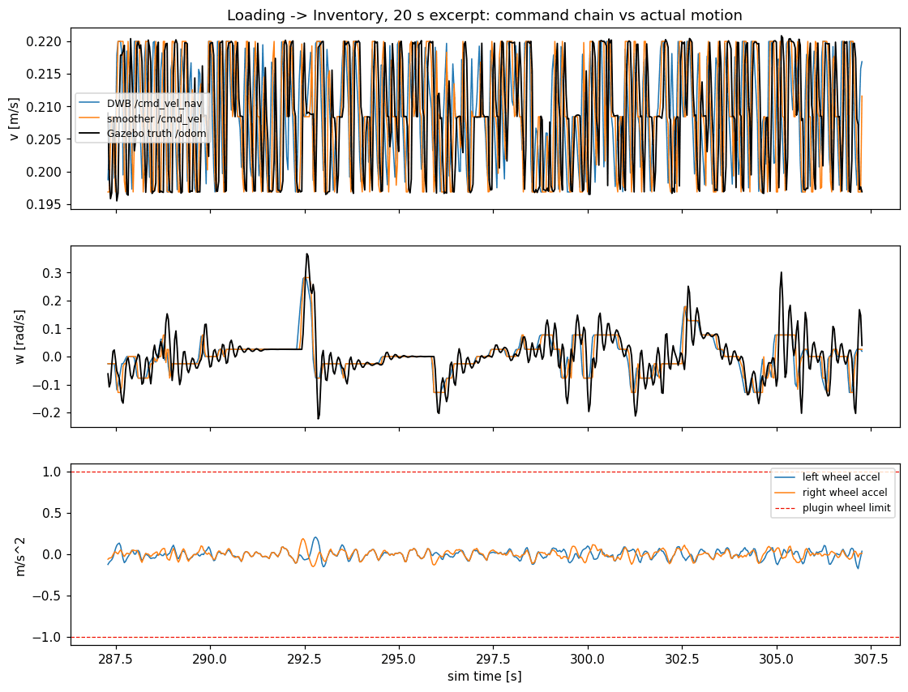
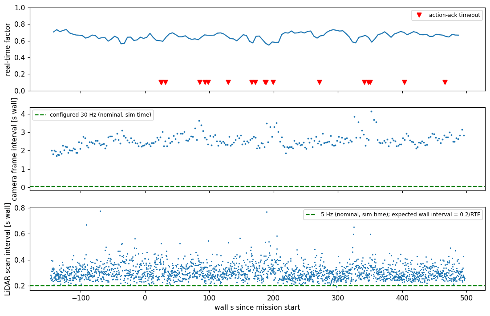

# Diagnostic investigation of v1.0.1 navigation behaviour

*Simulation-only case study, 2026-11-25.
> **Interpretation note (added in Phase 2b).** This report calls the PGM value 205 "never observed". Phase 2b
> showed that maps saved by Cartographer + `map_saver_cli` with default thresholds also write **observed but
> low-confidence** cells as 205. For the first Phase 2b map, Cartographer's raw grid had 41,413 never-observed cells
> and 21,258 observed with probability 25–64; 61,997 cells were saved as 205, the rest sit at threshold boundaries. The original map was presumably saved the same way; no Cartographer state exists to
> measure the split for it. All measurements here are unchanged. Read "never observed" / "unobserved" as
> **"unknown in the saved map: unobserved or not confidently classified"**. See
> `docs/validation/phase2b_slam_remap/REPORT.md` §1.
 Baseline: tag `v1.0.1` (`01ce6a5`), Nav2 parameter file
sha256 `869d998…` (identical to Trials 10–12). Nothing in the robot, map, markers, parameters or
mission/perception code was changed for this investigation.*

The question was why a robot that completes all five mission steps still takes odd routes, moves
unevenly, rotates unexpectedly, and whether it is stationary when the mission reports completion.

## How to read this report

Every finding carries one evidence label:

| Label | Meaning |
|---|---|
| **CONFIG** | Confirmed configuration defect: verified in files, installed code or runtime parameter dumps |
| **MEAS** | Measured observation from recorded data, stated without interpretation |
| **CORR** | A correlation or association; it does not establish cause |
| **CAUSAL** | Established causal mechanism: a code path plus a time-ordered log/data sequence, or a quantitative model fitted independently of the data it predicts |
| **HYP** | Unconfirmed hypothesis, consistent with the data but not tested |
| **PROPOSED** | Proposed improvement, **not tested** |

## Summary

| # | Finding | Label |
|---|---|---|
| 1 | The SLAM map frame is rotated **2.05°** and offset ≈0.15 m relative to the Gazebo world frame. A rigid transform explains most of the map-to-world discrepancy, but meaningful residual errors remain: systematic regional shifts ≤ ≈5 cm; residual position error median 8.8 cm, p95 19.5 cm, max 25.0 cm, worst regional median 16.2 cm | MEAS |
| 2 | Station goals (approach poses 0.67–0.97 m in front of the markers) were measured in Gazebo's world frame but are executed in the map frame. The rigid transform from (1), fitted only to map geometry, predicts the measured station misses (0.18–0.50 m) to within 0.03–0.11 m | CAUSAL |
| 3 | Every Nav2-internal failure in the diagnostic run (13 planner, 6 controller) began with a BT "timed out waiting for action server to acknowledge goal request" (`default_server_timeout: 20` ms). These failures drove the Spin, Wait and BackUp recoveries | CAUSAL (timeout → failure → recovery) |
| 4 | *Why* acknowledgements exceeded 20 ms is not measured. CPU saturation (95% busy, load ≈30) is consistent with it but not proven | HYP |
| 5 | The station positioning errors (2) and the acknowledgement failures (3) are **independent** problems. No evidence links the map/frame misalignment to any recovery | — |
| 6 | DWB's acceleration limits (2.5 m/s²) exceed the Gazebo wheel limit (1.0 m/s²), but DWB rarely requested accelerations the wheels could not deliver (0.3% of commands). The visible steering weave is already present in DWB's command stream | CONFIG + MEAS |
| 7 | `velocity_smoother` and `smoother_server` run on wall-clock time with default parameters; the BT client node very likely does too | CONFIG |
| 8 | The camera delivered **0.4 frames/s wall** (configured 30 Hz) with ≈1.6 s latency. This bounds the 0.3–4.6 s arrival-to-confirmation delays | MEAS |
| 9 | Marker verification confirms marker identity in a 182° view; it does not confirm physical positioning | MEAS |
| 10 | At the four stations observed, true translation stopped before ARRIVED; residual yaw settled within 1.0–1.5 s. The final completion was **not observed** (simulator crash), and the success path does not check for a stop | MEAS / CONFIG / unresolved |

## Diagnostic mission outcome

The historical missions and the diagnostic experiment are separate results:

- **Historical missions** (Trials 10 and 12, CI runs 45570293516 and 45579301270) each completed all five
  steps. They are documented in `docs/trial_results.md` and unchanged by this study.
- **Diagnostic experiment (one instrumented mission, this report):**
  - Four station visits completed successfully and passed ArUco identity verification.
  - The fifth visit (return to the dock) was **incomplete**, because Gazebo crashed about 85 s into that leg.
  - Instrumentation interference is a **suspected, not confirmed**, cause of the crash (§9).
  - Whether the robot moves after a successful *final* mission completion **remains unresolved**.
  - The BT client node's runtime clock was **inferred** from code and data, not directly verified (§4.2).
  - The actual action-acknowledgement latency was **not measured** (§4.4).

## Evidence base and method

| Source | Content |
|---|---|
| Static analysis | Map PGM/YAML; world SDF and collision meshes, sliced at the LiDAR plane into a ground-truth raster (`scripts/map_vs_world.py`); robot SDF; Nav2 YAML; BT XML; installed Nav2 1.1.18 headers; mission and detector code |
| Historical logs | `audit_logs/` Trials 02–12 and CI run 99 (warning categories, arrival-to-marker intervals) |
| One instrumented mission | Fresh launch with the standard launch file and mission command. Recorded: rosbag (no images), `gz stats`, `gz model -p` probe, `top`, runtime parameter dumps, QoS info. Raw data kept locally, not versioned |

**Ground truth.** The robot's diff-drive plugin uses the default `odometry_source` (WORLD), so `/odom` is
Gazebo's world pose. Verified against `gz model -p`: 0.00 cm / 0.000° over 55 stationary samples (MEAS).
Scans projected from the true pose put 100% of endpoints within 10 cm of the true-geometry raster, which
validates both the truth source and the raster (MEAS).

---

## 1. Map, frames and localization

### 1.1 Rigid alignment first, distortion second

An earlier draft of this report called the map "bent" (≈0.45 m shift in the north). That draft compared the
map to the world **without first removing a rigid transform**. A rigid rotation of 2° about the origin moves
points 9 m away by ≈0.33 m, which mimics a bend. Corrected analysis (`scripts/rigid_alignment.py`):

| Fit (world = R·map + t) | Rotation | Translation | Map obstacles within 10 cm of true geometry |
|---|---|---|---|
| Identity (map frame taken as world) | 0 | 0 | 41% |
| (A) geometry-based: map obstacles to true geometry | **+2.05°** | (−0.142, −0.049) m | **84%** |
| (B) pose-based: 252 AMCL poses to Gazebo truth | **+2.06°** | (−0.121, −0.037) m | – |

The two fits use independent inputs and agree to 0.01° (MEAS). The map-to-world discrepancy is
**predominantly explained by a rigid transformation, but meaningful residual errors remain** (MEAS):

| Residual after the rigid transform | Value |
|---|---|
| Systematic regional shift (best extra translation per 4–5 m band, after fit A) | ≈ 5 cm or less |
| Position error median (AMCL vs truth, after fit B) | 8.8 cm |
| Position error 95th percentile | 19.5 cm |
| Position error maximum | 25.0 cm |
| Worst regional median (true y in [+2, +6)) | 16.2 cm |

The regional-shift figure says no band of the map is *systematically* displaced by more than about one cell.
It does not mean every point is accurate to 5 cm. The pose residuals combine AMCL error and local map
imperfections, which this study does not separate. The rotation most plausibly comes from the orientation of the
SLAM frame at the start of the manual mapping drive (HYP; the mapping session was not recorded).

*Map (black obstacles, grey = unknown: unobserved or low-confidence) against the true LiDAR-height geometry (green). The figure
uses the identity transform, so the 2° rotation appears as a growing offset toward the ends.*

### 1.2 Localization

| Quantity (AMCL vs truth, n = 252) | Raw | After rigid transform B |
|---|---|---|
| Position error median / p95 / max | 0.236 / 0.502 / 0.535 m | **0.088 / 0.195 / 0.250 m** |
| North (true y > 6) median | 0.470 m | 0.077 m |
| Centre (−2 < y < 2) median | 0.054 m | 0.104 m |
| Heading error median / p95 / max | 1.6° / 4.9° / 6.3° | (a 2.06° rotation is part of it) |

- Scan endpoints within 10 cm of a *map* obstacle: 78% at AMCL's pose vs 48% at the true pose (MEAS).
  AMCL localizes consistently with the map. The raw error is mostly the frame rotation.
- After the rigid fit, a residual of ≈0.05–0.25 m remains, with spatial structure (figure). This is AMCL
  error plus small map imperfections. The two are not separated further (MEAS + limitation).
- One abrupt heading correction of 5.4° occurred at t = 228 s while the robot turned in place in the narrow
  Loading Zone pocket (MEAS). Its cause is not established (HYP: few distinctive features in view while rotating).
- AMCL reports a median yaw 1σ of 15.5°, much larger than the measured heading error (MEAS).

### 1.3 Map file

- 60.1% of PGM pixels have value 205 (unknown: unobserved or not confidently classified). With `free_thresh: 0.25` they load as **free**
  (occupancy 1 − 205/255 = 0.196 < 0.25). The loaded map has no unknown cells (CONFIG).
- The map's free space connects to the image border even after inflating obstacles by the 0.14 m robot
  radius. The perimeter, mainly the east wall behind the shelves, is not closed. This test does not depend on
  frame alignment (MEAS). In this run no plan left the building (0 of 129,424 plan poses): **latent** (MEAS).
- The pallet-jack forks lie below the 0.18 m LiDAR plane and are not in the map. The route passed them with
  clearance in this run (MEAS; latent).

## 2. Station positioning (separate from navigation failures)

| Station | True stop miss | Predicted by rigid fit A | Residual | True yaw miss | Marker bearing off camera axis |
|---|---|---|---|---|---|
| Home Charging Dock | 0.504 m | 0.508 m | 0.039 m | +9.6° | −37° |
| Loading Zone | 0.404 m | 0.476 m | 0.072 m | +9.5° | −41° |
| Inventory Scan Station | 0.176 m | 0.180 m | 0.032 m | +8.9° | −18° |
| Dispatch Zone | 0.316 m | 0.259 m | 0.113 m | −2.4° | −26° |

**Mechanism (CAUSAL).** The station goals are approach poses about 0.67–0.97 m in front of the markers, not the
marker positions. They were measured in Gazebo's world frame (their x-coordinates match the marker
x-coordinates in the world file). Nav2 executes them in the map frame, which is rotated 2.05° and translated
relative to the world. Fit A was obtained from map geometry alone, yet it reproduces the measured misses
within 0.03–0.11 m. The remainder is within AMCL residual error and the 0.12 m goal tolerance.

This is a **frame-definition error**, not a navigation-quality problem: Nav2 reached the requested map
coordinates. It does not explain any recovery behaviour (§4).

## 3. Global planning (NavFn)

Humble ignores the YAML key `default_bt_xml_filename`, an older parameter name, so the stock
`navigate_to_pose_w_replanning_and_recovery.xml` runs. It replans every second and retries/recovers on any
child FAILURE (CONFIG, effect benign).

| Leg | Plans | Successive-plan change p95 / max | Executed | Shortest on true geometry | Excess |
|---|---|---|---|---|---|
| Spawn → Dock | 74 | 0.10 / 0.21 m | 11.80 m | 11.02 m | +7% |
| Dock → Loading | 76 | 0.11 / 0.17 m | 9.05 m | 7.02 m | +29% |
| Loading → Inventory | 133 | 0.05 / 0.06 m | 18.58 m | 18.30 m | +2% |
| Inventory → Dispatch | 44 | 0.11 / 0.12 m | 5.52 m | 5.52 m | 0% |
| Dispatch → Dock | 81 | 0.05 / 0.05 m | incomplete (crash) | 18.62 m | – |

- No route switch (> 0.5 m change between consecutive plans) occurred, and the executed path was within 1% of
  the first plan on every leg (MEAS).
- The extra length on Dock → Loading is consistent with NavFn minimizing *cost* rather than length: the 0.5 m
  inflation favours aisle centres around a cluster of real obstacles (HYP for the attribution; the length itself is MEAS).
- Planner failures in this run were acknowledgement timeouts (§4), not "no path found" (MEAS).

## 4. Action-acknowledgement timeouts and recoveries

### 4.1 What the installed code does

Source: `/opt/ros/humble/include/nav2_behavior_tree/bt_action_node.hpp` (nav2_behavior_tree 1.1.18).

1. `send_new_goal()` stores `time_goal_sent_ = node_->now()` and sends the goal asynchronously.
2. On every tick while the goal response is pending: `elapsed = node_->now() - time_goal_sent_`, measured on
   **the BT client node's ROS clock**.
3. `is_future_goal_handle_complete(elapsed)` blocks in `callback_group_executor_.spin_until_future_complete(future, timeout)`
   with `timeout = min(server_timeout − elapsed, bt_loop_duration / 2)`. That wait is bounded by the
   executor's **steady clock**: at most 5 ms per tick here (`bt_loop_duration` 10 ms). Afterwards
   `elapsed += timeout` adds the *nominal* wait, not the measured one.
4. If no response yet and `elapsed < server_timeout` → RUNNING. Otherwise the node logs
   "Timed out while waiting for action server to acknowledge goal request" and returns **FAILURE**.
5. In the stock BT, a FAILURE of `ComputePathToPose`/`FollowPath` triggers a costmap clear. A repeated failure
   makes `NavigateWithReplanning` fail, which runs one round-robin recovery: clear costmaps, Spin, Wait, BackUp.

### 4.2 Which clock the elapsed time uses (CONFIG, supported by data)

`node_` is the BT client node `bt_navigator_navigate_to_pose_rclcpp_node`, created by `BtActionServer`
with fresh `NodeOptions`. Parameters are copied from `bt_navigator` with `nav2_util::copy_all_parameters`,
which only declares parameters the child does **not** already have. `use_sim_time` is pre-declared on every
`rclcpp::Node` (default false), so it is not copied. The YAML has no section for this node: it has the
obsolete name `bt_navigator_rclcpp_node`. So the elapsed time is almost certainly measured on the **system clock**.

The runtime parameter dump of `bt_navigator` timed out, so this was not read back directly. A data test
supports it (`scripts/ack_timeout_phase.py`). `/clock` advances in exact 0.1 s sim steps, received every
≈145 ms wall. If elapsed were sim time, a timeout could only be detected just after a `/clock` arrival.
Instead the 19 timeouts are spread uniformly over the inter-clock period (11% in the first 15%; KS test
vs uniform p = 0.85) (MEAS).

Consequences:

- The effective budget is **20 ms of wall time** from send to acknowledgement, checked across several BT ticks.
- If the client node were switched to sim time, the 0.1 s clock quantization would matter. `elapsed` would jump
  0 → 100 ms at the first clock update. Because of the strict `<`, any `server_timeout` ≤ 100 ms would then
  fail at the first clock update without an acknowledgement. 100 ms would behave exactly like 20 ms.

### 4.3 Established sequence in the diagnostic run (CAUSAL)

All 19 distinct `ComputePathToPose`/`FollowPath` failures in the BT log coincide, within ±0.05 s, with an
acknowledgement-timeout warning for the same action. Of 19 failures, 0 lack one. The ±0.05 s comes from
comparing launch-log timestamps with bag receipt times (`data/run/events.txt`):

| Mission time (wall) | Timeout for | BT consequence | Robot motion |
|---|---|---|---|
| 24.8 s | compute_path, follow_path | first attempt failed, retried | none visible |
| 98.5 s | follow_path | FollowPath ×2 fail → **Spin** (exceeded its 10 s sim time allowance, 14.8 s wall) → Wait | in-place rotation near the dock |
| 129.8 s | compute_path | planner + clear fail → **BackUp** | reversing away from the dock |
| 166–466 s | 9 more | costmap clears, replans | brief stops |

Totals: 13 `compute_path_to_pose` and 6 `follow_path` timeouts. Zero "No valid trajectories", zero "Failed to
make progress", zero collisions (MEAS). **The unexpected spin and back-up in this run were recoveries
triggered by acknowledgement timeouts, not by obstacles or localization.** No evidence links them to the
frame misalignment of §1–2.

### 4.4 Why acknowledgements were late (HYP)

Not measured: the acknowledgement latency itself was not recorded. Consistent observations (MEAS/CORR):
CPU 95% busy with load average ≈30 on 8 logical CPUs; `/odom` and `/clock` delivery gaps up to 0.38–0.54 s
wall; timeouts occurred at all RTF levels (correlation of RTF with controller misses per 10 s ≈ −0.02).

Historical acknowledgement-timeout counts per run (`audit_logs/`, MEAS):

| Run | 02 | 03 | 04 | 05 | 06 | 08 | 10 | 11* | 12 | CI 99 | diagnostic |
|---|---|---|---|---|---|---|---|---|---|---|---|
| GUI | on | on | on | off | off | on | on | on | on | Xvfb | on |
| Pre-mission RTF | 0.70 | 0.74 | 0.65 | 0.88 | 0.87 | 0.63 | 0.67 | 0.68 | 0.31 | 0.84 | ≈0.66 |
| Ack timeouts | 13 | 10 | 10 | 3 | 3 | 17 | 10 | 10 | 41 | 1 | 19 |

\* interrupted. The highest count (Trial 12) came from the most heavily loaded host (load average 21), and the
lowest from the headless and CI runs. That pattern is consistent with load dependence (CORR). Run lengths,
code and configuration differ, so it is not a controlled comparison.

### 4.5 Changing the timeout (PROPOSED, untested)

Raising `default_server_timeout` would tolerate acknowledgement latencies up to the new budget, **if** the
clock is wall time as argued above. It would **not** remove failures caused by stalls longer than the budget,
and stalls of several hundred ms were observed. It also delays detection of a genuinely unresponsive server.
The acknowledgement-latency distribution should be measured before choosing a value. The value of 100 ms
suggested in an earlier draft is not justified by data.

### 4.6 Trials 05–06, re-interpreted

Earlier project notes concluded that headless running raised RTF but degraded navigation. An earlier draft of
this report suggested the same acknowledgement-timeout mechanism. **That suggestion was wrong.** From
`audit_logs/launch_trial05.log` and `launch_trial06.log` (MEAS):

- Only **3** acknowledgement timeouts in each trial, against 10–13 in the GUI trials 02–04 with the same
  configuration. They cannot account for 53 and 24 planner failures.
- Failures were geometric: `GridBased: failed to create plan with tolerance 0.5` (53 and 24), controller
  "No valid trajectories", "Failed to make progress", and "None of the points of the global plan were in the
  local costmap". Trial 06 also logged AMCL "Please set the initial pose".
- Configuration at `00b70b6` was the **old** one: `robot_radius` 0.10, inflation 0.2 m (cost scaling 3.0),
  voxel layer, goal tolerance 0.05 m / 0.05 rad, no AMCL `set_initial_pose`.

Trials 02–04 used the same old configuration with the GUI and went 15/15. Within that configuration,
headless running is associated with the failures (CORR, n = 2 vs 3). It is also associated with *fewer*
acknowledgement timeouts, which is consistent with lower CPU load (HYP). The mechanism differs from the
present acknowledgement timeouts, and the result **cannot be transferred** to the current configuration,
which has a larger footprint and inflation, wider tolerances and initial-pose seeding.

## 5. Local control and actuator dynamics

### 5.1 Configuration (CONFIG)

| Element | Linear | Angular | Clock |
|---|---|---|---|
| DWB `acc_lim` / `decel_lim` | ±2.5 m/s² | ±3.2 rad/s² | sim (period 0.1 s) |
| velocity_smoother (no YAML section → Humble defaults) | ±2.5 m/s², max 0.5 m/s | ±3.2 rad/s², max 2.5 rad/s | **wall** (20 Hz) |
| Gazebo diff-drive `max_wheel_acceleration` | 1.0 m/s² per wheel rim | ≤ 12.5 rad/s² (pure rotation, b = 0.16 m) | sim |

Under the wheel limit, the change reachable in DWB's 0.1 s period obeys |Δv| + |Δω|·b/2 ≤ 0.10 m/s.
DWB assumes ±0.25 m/s and ±0.32 rad/s, so its **linear** model is more permissive than the actuator.
Because the smoother runs on wall time, its 2.5 m/s² limit corresponds to ≈3.8 m/s² in sim time at RTF 0.66.
The limit units come from the parameter names and the empirical data below; the plugin source is not
installed locally.

### 5.2 Measured dynamics (`scripts/controller_dynamics.py`)

Method: `/odom` truth twist on sim stamps (29.4 Hz, uniform 34 ms), Savitzky–Golay derivative over a 0.30 s
window. Wheel rim speeds are v ∓ ω·b/2. Command times are reconstructed from bag receipt via `/clock`
interpolation (uncertainty ≈ ±0.05 s sim).

| Quantity (during navigation) | p50 | p95 | p99 | max |
|---|---|---|---|---|
| Body linear acceleration | 0.02 | 0.10 | 0.27 | 0.75 m/s² |
| Body angular acceleration | 0.13 | 0.99 | 2.10 | 5.76 rad/s² |
| Worst wheel rim acceleration | 0.04 | 0.15 | 0.36 | 0.77 m/s² |

- Filter sensitivity: the max wheel acceleration is 1.17 m/s² with a 0.17 s window and 0.53 m/s² with a 0.50 s
  window. The limit is reached only in isolated, noise-sensitive samples (MEAS).
- Starts from rest reached 90% of 0.2 m/s with mean accelerations of 0.16–0.74 m/s², below the wheel limit (MEAS).
- DWB commands needing > 1.0 m/s² at a wheel to be reached within 0.1 s: **0.3%** (> 0.5 m/s²: 1.7%).
  87% of those were dominated by the linear term (MEAS).
- Lags from cross-correlation: DWB → smoother 33–67 ms, smoother → truth 67 ms, DWB → truth 100 ms (v) and
  133 ms (ω), at 33 ms grid resolution (MEAS).
- Tracking after removing the lag: |v error| p95 0.017 m/s; |ω error| p95 0.154 rad/s (MEAS).

**Conclusion.** The acceleration mismatch is a real configuration inconsistency, but in this run the actuator
constraint **did not materially prevent** the robot from executing DWB's commands. DWB rarely requested large
steps. The recorded data cannot show how DWB would behave in situations where it does demand large steps.

### 5.3 Steering oscillation

- Path tracking is good: cross-track error median 1.5–2.7 cm, p95 ≤ 7.6 cm (MEAS).
- The visible weave (0.3–2 Hz yaw-rate RMS ≈ 0.097 rad/s) has the same amplitude in the DWB command, the
  smoother output and the true motion. **It originates in DWB's command selection** and is executed
  faithfully (MEAS).
- In the 2–5 Hz band the true yaw rate has twice the RMS of any command (0.086 vs 0.042–0.044 rad/s). After
  command steps the true yaw rate overshoots by ≈30% and rings, an underdamped response of the simulated
  robot (MEAS). The cause is not established (HYP: caster/contact dynamics or the plugin's velocity control).
- Association between actuator demand and oscillation over 126 two-second windows: Spearman +0.19 to +0.29
  (CORR, weak). This is confounded, because windows with turns have both larger demand and more yaw activity.
  **No causal link between the acceleration mismatch and the oscillation is supported.**
- Executed rotation exceeded the minimum implied by the plan geometry by 17–277° per leg (MEAS). It comes
  from the accumulated weave and, on the first leg, the Spin recovery.

## 6. ArUco verification

- **Geometry (MEAS).** Goal-to-marker distance is 0.67 m (three stations) and 0.97 m (Inventory). The markers
  are visual-only and stand ≈0.30 m in front of the wall face. Camera: Gazebo `wideanglecamera`, 182°
  horizontal, 320×240. A 0.28 m marker spans ≈41 px at 0.67 m and ≈28 px at 0.97 m.
- **Camera timing (MEAS).** 0.60 frames per sim second (0.40 per wall second) against 30 Hz configured;
  inter-frame gap median 2.5 s wall; image age on arrival ≈1.65 s sim.
- **Arrival to confirmation (MEAS).** Diagnostic run 0.36, 0.95, 1.12, 2.27 s; historical 0.28–4.60 s.
  All are shorter than the observed inter-frame gaps (up to 4.1 s). The delay is bounded by frame delivery.
  Why the camera is so slow is not isolated (HYP: wide-angle cube-map rendering on a saturated CPU).
- **Detection (MEAS).** 100% of frames in the 3 s after arrival contained the expected ID, at bearings up to
  41° off-axis and with the robot 0.18–0.50 m from the intended spot.
- **Goal tolerances** (0.12 m / 0.15 rad) are irrelevant to visibility at this field of view (MEAS).
- **Interpretation.** A successful verification establishes marker *identity* within a 182° view, not
  physical positioning.
- **Code-level risks (HYP, not observed).** The detector publishes only `ids[0]`. Marker messages carry no
  image timestamp, so "after arrival" means *received* after arrival. With ≈1.6 s image latency, a frame
  captured before arrival can confirm a station.

## 7. Synchronization and computational performance

| Quantity | Value | Label |
|---|---|---|
| RTF | mean 0.66 (10 s windows 0.57–0.74) | MEAS |
| CPU | 95% busy median of 8 logical CPUs; load average ≈30 | MEAS |
| Per process (% of one core) | gzserver 263, gzclient 146, rviz2 80, Nav2 container 71, mission 23; instrumentation ≈54 (`gz` CLI 34 + `ros2` CLI 20) | MEAS |
| Sensor rates (sim) | scan 4.96 Hz, odom 29.4 Hz, map→odom 4.96 Hz, camera 0.60 Hz | MEAS |
| TF stamp age on receipt | scan/odom ≈0 ms (p95 12 ms); map→odom −0.98 s (AMCL `transform_tolerance` 1.0, by design) | MEAS |
| AMCL scan → pose latency | median 73 ms, p95 147 ms (wall) | MEAS |
| QoS | All pairs compatible; only RViz `/particle_cloud` mismatched (display only) | MEAS |
| `use_sim_time` false | `velocity_smoother`, `smoother_server`; BT client node (§4.2) | CONFIG |
| Controller loop | wall-rate 10 Hz → ≈9 Hz wall / 14 Hz sim achieved | MEAS |
| BT "tick rate exceeded" (3,901), planner "missed 20 Hz" (74) | warn when one tick > 10 ms or one plan > 50 ms wall; no failure associated | MEAS (benign) |

## 8. Mission completion

- **Code (CONFIG).** `finish_mission()` reports "WAREHOUSE MISSION COMPLETE" without any stationary or idle
  check. The odometry stop check runs only after a halt. Intermediate stations are checked indirectly: the
  gate before the next goal requires a 1 s (sim) stationary hold.
- **Measured at four stations (MEAS, wall seconds relative to the ARRIVED log line):**

| Station | Last nonzero DWB cmd | Last true motion | Marker confirm | Max true |v| / |ω| after ARRIVED | Displacement to TASK COMPLETE |
|---|---|---|---|---|---|
| Dock | −0.05 s | −2.54 s | +0.36 s | 0.1 mm/s / 0.000 rad/s | 0.0 mm |
| Loading | −0.07 s | +0.95 s | +0.95 s | 0.5 mm/s / 0.072 rad/s | 0.0 mm |
| Inventory | −0.09 s | +1.22 s | +1.12 s | 0.9 mm/s / 0.096 rad/s | 0.0 mm |
| Dispatch | −0.23 s | +1.52 s | +2.27 s | 0.8 mm/s / 0.332 rad/s | 0.0 mm |

- Translation had stopped at ARRIVED. A small residual yaw rate decayed within 1.0–1.5 s wall, and at three
  stations the marker was confirmed during that settling (MEAS).
- **Unresolved.** The final step was not observed (§9.1). Whether the robot moves after the final success
  report remains open. Trial 12's orphaned `follow_path` motion followed an *abort*, not a success.

## 9. Experimental limitations

1. **Gazebo crash.** 85 s into the return leg, gzserver aborted with a Gazebo transport assertion
   (`shared_ptr<gazebo::transport::Connection>`, `px != 0`). `/clock` stopped. The mission manager's watchdog
   halted the mission (exit 2) and correctly reported "ROBOT STOP NOT VERIFIED: no recent odometry".
2. **Possible instrumentation interference.** The assertion appears in no historical log. Before the crash,
   11 calls of the once-per-second `gz model -p` probe hung and were killed by `timeout`. Killing transport
   clients mid-connection is the most plausible trigger (HYP, not reproduced). Instrumentation also used
   ≈0.5 core, on top of a CPU already 95% busy. Timing results, ack timeouts in particular, may be slightly
   worse than in an uninstrumented run.
3. **Incomplete return-home leg.** Leg 5 has 9.4 of 18.6 m. No final arrival, final marker or completion data.
4. **Coordinate frames.** "Truth" is the Gazebo world frame; AMCL is in the map frame. Raw differences
   include the 2.05° frame rotation. Rigid fits A and B estimate it, but B uses the same AMCL data it then
   corrects, so the post-fit residual is optimistic. Station-miss predictions use fit A, which is independent.
5. **Ground truth.** `/odom` = Gazebo world pose, validated only at stationary samples; the probe has ≈3 s
   resolution. Velocity commands are unstamped; their sim time comes from receipt time (±0.05 s). Action
   status topics were not recorded (hidden topics need `--include-hidden-topics`), so goal boundaries come
   from mission-log wall times.
6. **Sample size.** One run, one host, four completed legs. No repeat measurements; all distributions are within-run.
7. **Clock of the BT client node.** Inferred from code and a statistical test, not read back at runtime.
8. **Wheel-limit semantics.** Inferred from parameter names and data; plugin source not available locally.

## 10. Future improvement backlog (all PROPOSED, none tested)

None of these were implemented. Any future configuration change requires fresh validation against the
preserved v1.0.1 baseline (tag `v1.0.1`, parameter sha256 `869d998…`) with before/after measurements.

1. **Correct the map-to-world coordinate-frame mismatch.**
   - Consider transforming the intended station poses into the existing map frame, or correctly transforming
     the occupancy map into the intended reference frame.
   - Before considering a map-origin yaw change, verify compatibility with Nav2's occupancy-grid and costmap
     implementations.
   - Derive the transformation direction and signs from the measured convention **world = R × map + t**
     (R: +2.05°, t ≈ (−0.142, −0.049) m from fit A).
   - Account for AMCL initialization (`set_initial_pose` / `initial_pose`) and all other
     coordinate-dependent configuration.
2. **Correct unknown-space classification** (`free_thresh` vs the 205 "unknown" value) and evaluate the
   planner's unknown-space policy (`allow_unknown`, `track_unknown_space`).
3. **Experimentally evaluate action-acknowledgement timeout settings**, after measuring acknowledgement latency.
4. **Improve clock consistency** (`velocity_smoother`, `smoother_server`, BT client node) **and camera
   performance**.
5. **Investigate the DWB steering oscillations**, using the metrics in `scripts/controller_dynamics.py`.
6. **Verify stationary behaviour before final mission completion.**

Instrumentation lesson for any future experiment: take ground truth from a `gazebo_ros` state/p3d plugin
instead of polling `gz`, record hidden action topics, and log acknowledgement latency.

## 11. Corrections to the earlier draft

| Earlier claim | Correction |
|---|---|
| Map is "bent", ≈0.45 m shift in the north | Predominantly a 2.05° rigid frame rotation; regional systematic shifts ≤ ≈5 cm remain, and residual position errors of 8.8 cm median / 25.0 cm max |
| Raise the timeout to 100 ms to remove the trigger for every failure | Untested; no latency data; would not cover longer stalls; equivalent to 20 ms if the client used the quantized sim clock |
| Trials 05–06 "likely the same ack-timeout mechanism" | Only 3 ack timeouts per trial; failures dominated by geometric planning failures under the old configuration |
| DWB acceleration mismatch contributes to weaving | Mismatch rarely exercised; weave originates in DWB commands; association weak and confounded |

## Reproduction

See [`README.md`](README.md) in this folder.
