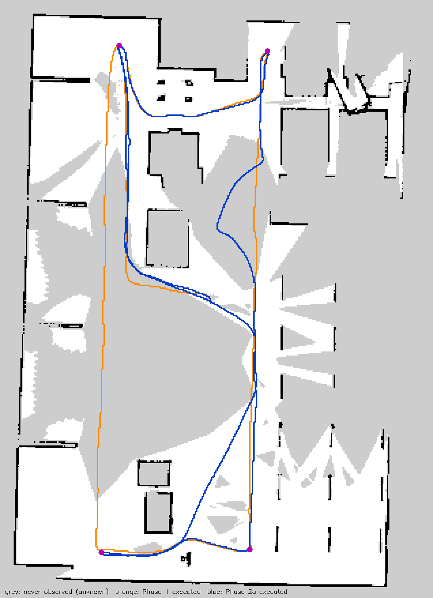

# Phase 2a validation: occupancy classification and penalized unknown space

*Branch `feat/map-unknown-space`, based on the validated Phase 1 commit `69befa2`.
> **Interpretation note (added in Phase 2b).** This report calls the PGM value 205 "never observed". Phase 2b
> showed that maps saved by Cartographer + `map_saver_cli` with default thresholds also write **observed but
> low-confidence** cells as 205. For the first Phase 2b map, Cartographer's raw grid had 41,413 never-observed cells
> and 21,258 observed with probability 25–64; 61,997 cells were saved as 205, the rest sit at threshold boundaries. The original map was presumably saved the same way; no Cartographer state exists to
> measure the split for it. All measurements here are unchanged. Read "never observed" / "unobserved" as
> **"unknown in the saved map: unobserved or not confidently classified"**. See
> `docs/validation/phase2b_slam_remap/REPORT.md` §1.
 One validation mission,
compared with the Phase 1 mission using the same analysis scripts. Phase 2a is an intermediate step;
**preventing** traversal of unknown space is left to Phase 2b (re-mapping).*

## What changed

| File | Change |
|---|---|
| `src/warehouse_bringup/maps/warehouse_map.yaml` | `free_thresh: 0.25 → 0.01`, with an explanatory comment. Image, origin, resolution, `occupied_thresh` and `mode` unchanged. |
| `src/warehouse_bringup/test/test_map_classification.py` | 6 tests: PGM values, unchanged geometry, threshold inside the verified window, station goals on known-free cells (Nav2 indexing), unknown-space policy configuration, and an **integration test** that runs the real `nav2_map_server` and checks the loaded `OccupancyGrid`. |
| `.github/workflows/warehouse-humble.yml` | The test job also installs `ros-humble-nav2-map-server`, so the integration test runs in CI instead of being skipped. |

**Unchanged:** the Nav2 parameter file (byte-identical, sha256 `869d998…`), which still has global costmap
`track_unknown_space: true` and NavFn `allow_unknown: true`. Also unchanged: the Phase 1 station goals, AMCL
initialization, sensor clearing (`inf_is_valid` not enabled), controller, timeouts, camera, mission manager
and perception.

## 1. Occupancy classification

### Theory vs the installed map_server

`nav2_map_server` computes `occ = 1 − shade`. By the textbook formula, the PGM value 205 (unknown: unobserved or low-confidence)
has `occ = 1 − 205/255 = 0.196`, which is below `free_thresh: 0.25`, so it loads as **free**, as found in the
diagnostics. The textbook fix would be any threshold ≤ 0.196. **The installed builds do not decode the map
that way.** The threshold sweep runs the real `map_server` and reads the published grid
(`data/offline/loaded_map_values.txt`, `sweep_ci_container.txt`, `investigate_ci_container.txt`):

| `free_thresh` | 1.1.18 (local, GraphicsMagick Q16 1.3.38) | 1.1.20 (CI image `ros:humble-ros-base-jammy`, same GraphicsMagick) |
|---|---|---|
| 0.25, 0.19 | 205 → free (0 unknown) | 205 → free (0 unknown) |
| 0.15, 0.10, 0.05 | 205 → free | 205 → **unknown** |
| 0.03 | 205 → free | 205 → unknown |
| 0.025 … 0.0005 | 205 → **unknown** | 205 → unknown |
| 0.0002 | – | 205 → unknown, 254 → free |

From the sweep:

- **1.1.18** decodes 205 to an occupancy in [0.025, 0.03). **1.1.20** decodes it to one in [0.15, 0.19).
- Both decode 254 below 0.0002–0.0005, against the textbook 0.0039.
- The upstream `map_io.cpp` is **byte-identical** at tags 1.1.18 and 1.1.20, so the difference does not come from
  a change to that source file. It probably lies in the binary build or link environment, but that underlying
  mechanism has **not been conclusively established**. The difference itself is established experimentally.

**Chosen value: 0.01.** It produces the identical, correct grid in both supported environments, with margin:
2.5× below the lowest observed 205 level and ≥ 20× above the 254 level. It is **empirical for this map and
these builds, not a universal threshold**. The regression test checks the loaded grid itself:

| Load | Occupied | Free | Unknown |
|---|---|---|---|
| v1.0.1 (`free_thresh 0.25`) | 3,772 | 135,830 | 0 |
| **Phase 2a (`free_thresh 0.01`)**, 1.1.18 and 1.1.20 | **3,772** | **51,911** | **83,919** |

**Negative control.** The integration test fails at the cell-count assertion when pointed at a copy of the
map with `free_thresh: 0.25`.

### Costmap layers (verified with the real planner_server, no Gazebo)

With the corrected map and no sensor data, the global costmap keeps **77,581 unknown cells** (`dryrun_B`).
The static layer keeps unknown cells unknown (`track_unknown_space: true`). The obstacle layer does not
overwrite them until the LiDAR actually observes them: it clears along beams that **hit** something, and
`inf_is_valid` is false. A real-geometry scan from the spawn pose cleared only 73 cells (`dryrun_C`). The real
LiDAR at spawn returns 83 hits out of 360 beams; the synthetic scan returned 88.

**Static unknown vs live-observed.** In the analysis below:

- *static-unknown* = PGM value 205: not observed, or not confidently classified, while mapping;
- *live-unknown* = still −1 in the recorded global costmap at that moment. This is **not proof that the LiDAR never
  observed the cell**: the obstacle layer clears only along beams that return a hit, and the snapshot is up to 1 s old.

## 2. Planner policy (intermediate)

Unknown space is **still traversable** in Phase 2a (`allow_unknown: true`). What changed is that it is now
*represented*, so NavFn penalizes it.

**Measured NavFn cost of unknown** (`scripts/navfn_unknown_cost.py`, `data/offline/navfn_unknown_cost.txt`).
The experiment uses the real `planner_server` on a synthetic map: a 1 m-deep unknown block between start and
goal, with the block's width varied. The planner detours around blocks up to 7 m wide and crosses blocks from
8 m. Crossing 1 m of unknown therefore costs as much as **≈4.2–5.8 m of free travel**, depending on whether
geometric or planned detour lengths are used. That agrees with the `navfn.hpp` constants (unknown → `COST_OBS−1`
= 253, free → `COST_NEUTRAL` = 50; ratio ≈ 5.06). Unknown cells are heavily penalized, **not forbidden**.
An earlier run of this experiment was discarded: leftover `planner_server` processes from previous cases had
answered goals.

**Why not prohibit unknown now** (`dryrun_B`, `dryrun_C`, `reachability_nav2.txt`):

- With `allow_unknown: false`, the real planner returns no plan for spawn→dock, loading→inventory and dispatch→dock.
- The known traversable space splits into a north region (Dock, Loading; 38.2 m²) and a south region (spawn,
  Inventory, Dispatch; 69.3 m²).
- The two regions are separated by **one unknown cell** at map (−2.335, +1.325). The west aisle was largely
  unknown in the saved map (unobserved or low-confidence).
- Neither region touches the map border, so the corrected classification removes the exterior connectivity.

Offline corrections made during this phase: cell indexing now follows Nav2 `worldToMap` (`floor`), and a
blocked cell (component label 0) is never treated as a region. With correct indexing the spawn cell is free
(clearance 1.52 m); an earlier statement that it was unknown was a half-cell rounding artifact.

## 3. Build and tests

- Local: `colcon build` OK. `colcon test`: **76 tests, 0 failures, 3 skipped** (70 before + 6 new).
- CI reproduction (`data/offline/ci_job_result.txt`): the `warehouse-tests` job's steps in
  `ros:humble-ros-base-jammy` with nav2-map-server 1.1.20 gave **76 tests, 0 failures, 3 skipped**. The
  integration test ran (0.61 s) and passed.
- One earlier local full run had 1 failure in a pre-existing test,
  `test_sigterm_to_installed_executable_cancels_goal_and_exits_130`. SIGTERM arrived inside rclpy
  `take_message`, raised `RuntimeError`, and the process exited 1 instead of 130. This is the signal-handling
  race already listed in the README's next steps. It passed 5/5 in isolation and in the next full run. The
  Phase 1 timing flake is still recorded in the Phase 1 report.

## 4. Validation mission (same lightweight instrumentation as Phase 1, plus `/global_costmap/costmap` at 1 Hz)

The runtime log confirms `map_io: free_thresh: 0.01`.

### Outcome and positioning

**5/5 tasks succeeded, exit code 0, all five markers verified.**

| Station | Phase 1 position / heading | **Phase 2a position / heading** | Arrival → confirm |
|---|---|---|---|
| Home Dock | 0.042 m / +6.9° | **0.057 m / +6.3°** | 0.57 s |
| Loading Zone | 0.084 m / −10.4° | **0.103 m / −11.5°** | 1.63 s |
| Inventory Scan | 0.051 m / +8.0° | **0.042 m / +7.9°** | 1.74 s |
| Dispatch Zone | 0.098 m / −7.0° | **0.024 m / −8.7°** | 1.87 s |
| Return Home | 0.102 m / −7.7° | **0.049 m / +7.4°** | 1.84 s |

- **Position, same station sets:** stations 1–4 mean 0.069 → 0.057 m; all five stations mean 0.076 → 0.055 m;
  max 0.102 → 0.103 m. Every station is ≤ 0.15 m.
- **Heading:** the goal checker again accepted estimates at the edge of the unchanged 8.59° tolerance (+8.1,
  −8.0, +8.0, −8.9, +7.7°). Localization adds −3.7° to +0.2°.

### Unknown-space traversal, path length, time and clearance

| Leg | First plan on static-unknown, Phase 1 → 2a | Executed on static-unknown, Phase 1 → 2a | Executed on live-unknown (2a) | Executed length, Phase 1 → 2a | Leg wall time, Phase 1 → 2a | Min clearance to true geometry, Phase 1 → 2a |
|---|---|---|---|---|---|---|
| Spawn → Dock | 5.95 m (52%) → **1.58 m (14%)** | 6.10 → **4.53 m** | 2.02 m | 11.88 → 11.42 m | 98.5 → 88.7 s | 0.65 → **0.29 m** |
| Dock → Loading | 0 → 0 | 0 → 0 | 0 | 8.65 → 8.74 m | 74.6 → 65.9 s | 0.46 → 0.46 m |
| Loading → Inventory | 5.50 m (30%) → **2.51 m (12%)** | 5.61 → **6.18 m** | 1.31 m | 18.35 → 19.52 m | 131.9 → 149.1 s | 0.50 → 0.50 m |
| Inventory → Dispatch | 1.05 m (19%) → **0** | 0.95 → **0** | 0 | 5.74 → 5.71 m | 47.2 → 52.8 s | 0.32 → 0.35 m |
| Dispatch → Dock | 13.35 m (72%) → **1.62 m (6%)** | 13.12 → **5.10 m** | 1.82 m | 18.60 → **24.74 m** | 153.1 → 173.0 s | 0.75 → **0.28 m** |
| **Total** | 25.85 → **5.71 m** | 25.78 m (40.8%) → **15.81 m (22.5%)**; 123.8 → 75.3 s sim | **5.14 m** | 63.2 → 70.1 m | 505 → 530 s | 0.32 → 0.28 m |

Reading the table:

- **Planned traversal** of static-unknown cells fell by 78% (25.9 → 5.7 m on the first plan of each leg).
- **Executed traversal** fell by 39% (25.8 → 15.8 m), and only 5.1 m of it was on cells **still unknown in the live
  costmap** at the time. A cell remaining unknown there is not proof that the LiDAR never observed it: no-return beams
  do not clear, and the snapshot is up to 1 s old. The rest was on cells the live costmap had already cleared
  from LiDAR returns during the mission.
- **Routes that avoided unknown** in Phase 1 still do (Dock → Loading). Inventory → Dispatch now avoids it entirely.
- **The one leg with more executed static-unknown travel** (Loading → Inventory, +0.57 m) is explained. As cells
  were observed, they dropped from cost 253 to free, and the planner moved onto that newly observed corridor.
  Two route changes resulted: 2.52 m at 30.3 s and 1.49 m at 51.9 s into the leg. Of the 6.18 m, 1.31 m was
  still live-unknown.
- **The return leg** became 33% longer (18.60 → 24.74 m, +20 s). The offline prediction was 24.91 m: the
  planner now prefers the confidently mapped central corridor over the largely unknown west aisle.
- **Clearance:** the Dock and Return routes now pass the central block's corner at world (−2.6, +1.0), the
  known-space pinch, with 0.28–0.29 m centre clearance, under 0.35 m for 1.9 s and 2.6 s. In Phase 1 the
  minimum on any leg was 0.32 m (Dispatch). No collision or contact was detected. Clearance is the robot
  centre to the true LiDAR-height geometry, ±0.025 m raster quantization; the configured robot radius is 0.14 m.



### Recoveries, timeouts and performance

| Quantity | Phase 1 | Phase 2a |
|---|---|---|
| Mission wall time | 573 s | 599 s |
| Ack timeouts (mission) | 16 (1.67 / wall min; 2.88 / sim min of navigation) | 15 (1.50 / wall min; 2.52 / sim min) |
| BT failure records (`ComputePathToPose`/`FollowPath`), all with a coinciding ack timeout | 17 | 15 |
| Recoveries | Spin, Wait, BackUp (1 each) | Spin (at spawn, 23.9 s), Wait, BackUp (1 each), each coinciding with an ack timeout |
| No valid trajectories / failed to make progress / "failed to create plan" | 0 / 0 / 0 | 0 / 0 / 0 |
| Route changes > 0.5 m between consecutive plans | 0 | **2** (Loading → Inventory) |
| RTF, CPU busy, load average | 0.660, 94%, 28.9 | 0.675, 94%, 27.8 |
| Camera | 0.61 Hz sim | 0.64 Hz sim |
| AMCL residual vs truth, fixed calibration (median / p95 / max) | 9.0 / 18.0 / 22.2 cm | 10.5 / 21.2 / 32.5 cm |
| Teardown | detector exit 1, RViz −11 | detector exit 1, RViz −11 (≈67 s after mission, after the observation window) |

The AMCL residual increase is measured. Its cause is **not established**. One hypothesis: the new routes cross
the central region, where the diagnostics found the largest residual map error (worst regional median 16 cm).

### Final stationary behaviour

The final NavigateToPose succeeded at 589.09 s. A residual turning motion (peak 0.12 rad/s, translation
< 1.2 mm/s) settled **1.26 s after the final NavigateToPose success**. Final *mission completion* (MISSION COMPLETE) was reported
9.5 s after that success. The robot was then stationary for the rest of
the observation window: 0.0 mm displacement, no nonzero velocity commands and no active Nav2 goals, through
MISSION COMPLETE (598.6 s) and 60 s after process exit.

## 5. Acceptance

| Criterion | Result |
|---|---|
| Unknown cells correctly represented | **Met.** 83,919 unknown cells in both supported environments; regression-tested against the loaded grid. |
| Reduced overall unknown-space traversal, without unexplained increases on individual legs | **Met.** Planned −78%, executed −39%, 5.1 m on cells still unknown in the live costmap. The one per-leg increase (+0.57 m) is explained by live clearing. |
| Routes that previously avoided unknown still do so | **Met.** Dock → Loading unchanged at 0; Inventory → Dispatch improved to 0. |
| Station positioning comparable to Phase 1 (≤ 0.15 m) | **Met.** Same station sets: stations 1–4 mean 0.057 m (Phase 1: 0.069 m); all five mean 0.055 m (Phase 1: 0.076 m); max 0.103 m (Phase 1: 0.102 m). |
| 5/5 steps, exit 0, all markers verified | **Met.** |
| No new release-blocking defects | **Met, with two non-blocking regressions to track:** (1) two mid-leg route changes on one leg; (2) lower minimum clearance (0.28 m) at the central-block corner, plus a 33% longer return leg. Both follow from penalizing unknown space while the map leaves only one observed corridor between north and south. Phase 2b re-mapping is expected to address them. |

**Three outcomes, kept distinct:**

- **Occupancy representation correction:** done and verified.
- **Reduction in unknown-space traversal:** achieved and measured (planned −78%, executed −39%).
- **Prevention of unknown-space traversal:** **not achieved.** It remains pending Phase 2b, because the
  current map's coverage does not connect the required routes through observed space.

**Phase 2a verdict: accepted as an intermediate phase.** Unknown space is now represented and penalized, not
prevented, and nothing here guarantees navigation safety.

## Limitations

- One validation run against one Phase 1 run; no repeat statistics.
- Phase 2a additionally recorded the global costmap at 1 Hz; RTF and CPU load were nonetheless unchanged.
- Live-unknown traversal uses the latest 1 Hz costmap snapshot and the obstacle layer's hit-only clearing, so the
  5.1 m measures cells still unknown in the costmap, not cells the LiDAR provably never saw. Phase 1
  cannot be given a live-unknown figure: its costmap had no unknown cells.
- Clearance is measured from the robot centre with ±0.025 m raster resolution. Footprint contact is not measured directly.
- The cause of the version-dependent PGM decoding was not traced into the binaries. The regression test guards
  the result, not the mechanism.

## Reproduction

The raw recordings (bag, launch log) are kept locally in the git-ignored `diagnostics_phase2/`. Scripts are in `scripts/`:

```bash
source /opt/ros/humble/setup.bash && source install/setup.bash
S=docs/validation/phase2a_map_unknown_space/scripts
python3 $S/reachability_nav2.py . diagnostics_phase2/offline                  # static reachability (Nav2 indexing)
python3 $S/planner_dry_run.py . <abs map yaml> <true|false> <none|spawn> <out>  # real planner_server dry run
python3 $S/navfn_unknown_cost.py . <out>                                      # NavFn unknown-cost experiment
python3 $S/unknown_traversal.py diagnostics_phase2/run . "Phase 2a"           # traversal, clearance, timing
python3 $S/leg_inspection.py diagnostics_phase2/run diagnostics_phase1/run . <out_dir>
python3 docs/validation/phase1_station_frames/scripts/phase1_evaluate.py diagnostics_phase2/run diagnostics_20261125/run .
```

Run `sweep.sh`, `investigate.sh` and `ci_job.sh` inside `ros:humble-ros-base-jammy` to reproduce the CI-environment results.
