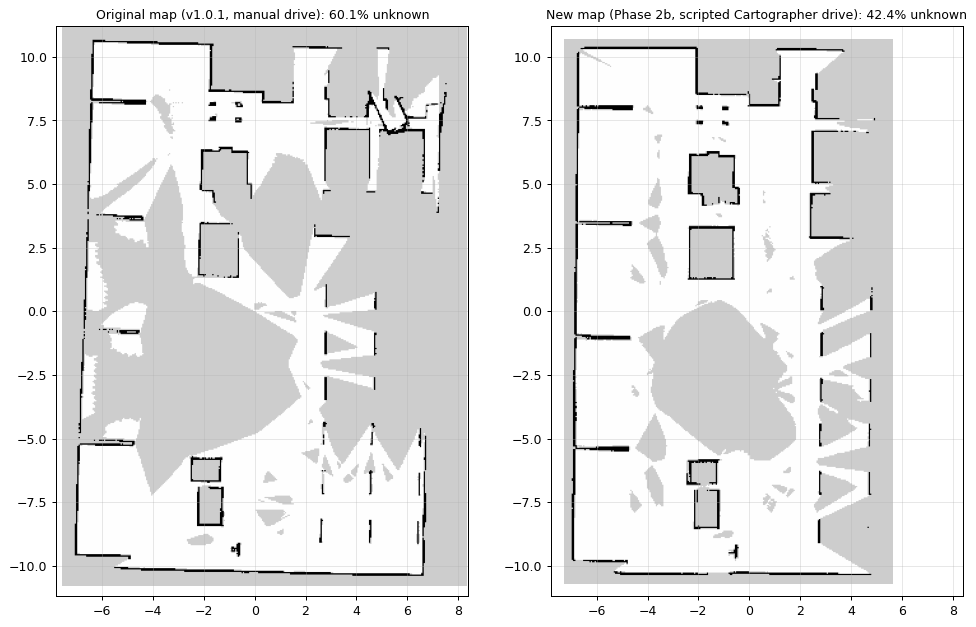
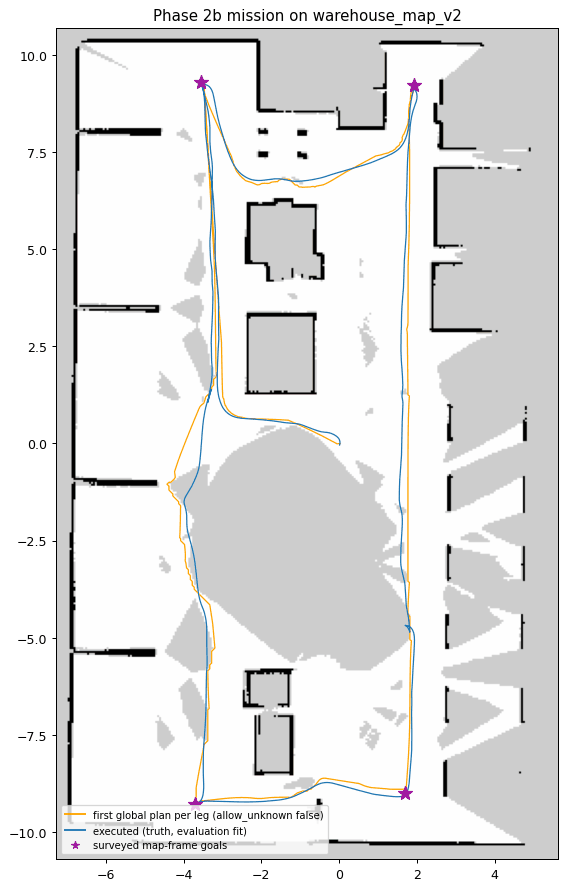

# Phase 2b validation: SLAM re-mapping, surveyed station goals and `allow_unknown: false`

*Branch `feat/slam-remap`, based on the complete Phase 2a (`8b048f6`). One validation mission, compared with
Phase 1 and Phase 2a using the same analysis scripts. Unchanged: camera, DWB controller, action timeouts, goal
tolerances, sensor-clearing policy and mission supervision.*

## Summary

| Measure | Phase 1 | Phase 2a | **Phase 2b** |
|---|---|---|---|
| Map | original (manual drive) | original | **new Cartographer map (scripted drive)** |
| Planner policy | unknown loaded as free | unknown represented, penalized | **unknown prohibited** (`allow_unknown: false`) |
| Station goals | world coords → map via GT calibration | same | **surveyed directly in the map frame** |
| Mission | 5/5, exit 0 | 5/5, exit 0 | **5/5, exit 0** |
| Markers verified | 5/5 | 5/5 | **5/5** |
| Station position error, stations 1–4 mean / all five mean / max | 0.069 / 0.076 / 0.102 m | 0.057 / 0.055 / 0.103 m | **0.078 / 0.076 / 0.116 m** |
| First plans over static-unknown cells (of the map in use) | 25.9 m | 5.7 m | **0.08 m** |
| Executed on live-costmap-unknown cells | n/a | 5.1 m | **2.9 m** |
| Return-home leg (executed) | 18.6 m | 24.7 m | **19.6 m** |
| Minimum clearance to true geometry (whole mission) | 0.32 m | 0.28 m | **0.36 m** |
| Route changes > 0.5 m during a leg | 0 | 2 (max 2.52 m) | **1 (0.77 m)** |
| Total executed distance / mission wall time | 63.2 m / 573 s | 70.1 m / 599 s | **64.2 m / 591 s** |
| Recoveries (Spin / Wait / BackUp) | 1 / 1 / 1 | 1 / 1 / 1 | **3 / 3 / 3** |
| Ack timeouts (per wall minute) | 16 (1.67) | 15 (1.50) | **19 (1.93)** |
| "Failed to create plan" | 0 | 0 | **1** |

Static-unknown means the PGM value 205 *of the map in use*. Phase 1 and 2a used the original map; Phase 2b uses
`warehouse_map_v2`. Those rows therefore compare policy outcomes, not identical cell sets.

## 1. Mapping drive (Cartographer, real simulated LiDAR)

**Method.**

- Stock TurtleBot3 Cartographer configuration (`turtlebot3_lds_2d.lua`, unmodified; sha256 in
  `data/mapping/meta_*.txt`), `use_sim_time`, fed by Gazebo's simulated LiDAR and odometry.
- A scripted, collision-aware coverage drive (`scripts/coverage_drive.py`) followed a route designed
  **with** Gazebo geometry (`scripts/coverage_route.py`). Occupancy comes only from Cartographer.
- Safety rules:
  - stop and abort on any forward return < 0.20 m or any return < 0.15 m;
  - pause on stale `/scan` or `/odom`, and abort after 15 s;
  - hard limits of 0.4 m/s and 0.6 rad/s;
  - zero velocity on exit.
- Every route segment was checked offline for robot-centre clearance against the true geometry: ≥ 0.45 m,
  except a documented pinch at 0.33 m. That pinch is the gap between the south block and the pallet jack,
  which the mission route must use.

| | Attempt 1 | Attempt 2 (targeted additional pass, final) |
|---|---|---|
| Route | 88.1 m, 6 spins (spawn, 4 stations, return); loops via both aisles, middle corridor, south traverse | Attempt 1 route + 2 slow west-aisle passes with 3 spins (130.9 m, 10 spins), 0.12 m/s (0.10 in the aisle) |
| Drive result | completed, minimum LiDAR range 0.331 m | completed, minimum LiDAR range 0.323 m |
| Cartographer cross-submap (loop-closure) constraints | 2,257 | 5,052 |
| Map save | live `map_saver_cli` timed out (2 s default); saved from the frozen `.pbstream` | live save (30 s timeout) |
| Unknown share / west-aisle coverage | 52.4% / 18% | **42.4% / 44%** |
| Real-NavFn return-home plan | 24.78 m (via the central-corner pinch) | **19.68 m** (west aisle) |

**Why a second pass was needed (`data/mapping/probability_bands_attempt1.txt`).**

- Corridors driven once at 0.15 m/s stayed *low-confidence*: Cartographer values 25–49, which `map_saver`'s
  default thresholds (free < 0.25, occupied > 0.65) save as 205.
- In attempt 1's raw Cartographer grid, 41,413 cells were never observed, 18,286 were observed but free-leaning
  (25–49) and 2,972 were observed, occupied-leaning (50–64). The saved map has 61,997 cells at 205; cells at the
  exact threshold values account for the difference.
- **So in maps saved this way, 205 means "not confidently classified", not strictly "never observed".** The
  original map was presumably saved by the same pipeline, so earlier phases' wording ("never observed") is an
  overstatement for it. This cannot be measured there, because no Cartographer state exists for the original map.
- The default save thresholds were **kept**. Bands 25–44 are about as reliable as saved-free cells (0.9–1.3%
  of them on true geometry, against 0.6%), so a higher threshold would be defensible, but it was not needed.

**Attempt-2 state reload is not faithful.** Reloading the attempt-2 `.pbstream` (frozen) re-renders about
13,000 observed cells outside the building, and registers poorly with the live-saved map (31.8% occupied
agreement). The live-saved map is therefore the artifact used. The attempt-1 reload showed no such artifact
(96% geometric agreement, building-sized extent).

**Origin precision.** `map_saver_cli` rounds the origin to about 3 significant figures: `[-7.28, -10.7, 0]`, so
±0.005 m in x and ±0.05 m in y relative to the Cartographer frame. Navigation, AMCL and the survey are
self-consistent in the loaded frame, so this only affects comparisons with Cartographer's own frame.

## 2. Map quality (`data/mapping/map_quality_*.txt`, evaluation against true geometry)

| Measure | Original map | **New map (attempt 2)** |
|---|---|---|
| Size / resolution | 318×439 @ 0.05 m | 258×428 @ 0.05 m |
| Occupied / free / unknown | 3,772 / 51,911 / 83,919 (60.1%) | **3,499 / 60,091 / 46,834 (42.4%)** |
| Map frame vs world (evaluation fit) | 2.06°, (−0.144, −0.050) m | **0.71°, (−0.009, +0.040) m** |
| Map obstacles within 10 cm of true geometry: identity → after rigid fit | 41% → 84% | 74% → **96%** |
| Residual regional shift after rigid fit | ≤ 5 cm | ≤ 5 cm |
| Corridor known-free: west aisle / east aisle / central crossing / middle corridor | 21 / 70 / 42 / 21% | **44 / 89 / 88 / 100%** |
| Station approach areas known-free | 100% | 100% |
| All mission points in one strict-policy region | no (two regions) | **yes (139.5 m²)** |
| Known region touches the map border (exterior) | no | **no** |

The large open floor in the centre and the far east bays beyond the shelving remain unknown.

**Does the central unknown region matter?** (`data/premission/central_region_analysis.txt`, evaluation only.)
The region (world x −3…1, y −5.5…0) is 91% unknown in v2. Shortest collision-free routes on the *true* geometry
were computed for all five legs:

| Leg | True-geometry shortest | Inside the central region | Strict NavFn plan on v2 | Plan / shortest |
|---|---|---|---|---|
| Spawn → Dock | 11.04 m | 0.00 m | 11.61 m | 1.05 |
| Dock → Loading | 7.07 m | 0.00 m | 8.65 m | 1.22 |
| Loading → Inventory | 18.30 m | 0.00 m | 18.30 m | 1.00 |
| Inventory → Dispatch | 5.57 m | 0.00 m | 5.63 m | 1.01 |
| Dispatch → Dock | 18.62 m | 0.00 m | 19.66 m | 1.06 |

**None of the optimal routes passes through the central region, so it does not materially affect the mission.**

- The +22% on Dock → Loading is NavFn's obstacle-cost preference in the north crossing. It appears with the
  original map too (Phase 1 executed 9.05 m against 7.02 m).
- The optimal return route crosses 9.95 m of v2-unknown cells. Those are the west aisle's low-confidence strips,
  not the central region, and the strict plan is only 6% longer.

No further mapping session was run.

## 3. Classification revalidated with the real map_server (both supported environments)

Each map was loaded with `nav2_map_server`, and every cell was compared with its PGM class
(`data/premission/percell_*.txt`):

| Map | 1.1.18 (local) | 1.1.20 (CI image) |
|---|---|---|
| `warehouse_map_v2.yaml` (`free_thresh 0.01`): 3,499 occupied, 60,091 free, 46,834 unknown | **0 cells differ** | **0 cells differ** |
| `warehouse_map.yaml` (original, preserved) | **0 cells differ** | **0 cells differ** |

`test_map_classification.py` now checks per-cell classification for both maps instead of fixed counts. It also
checks the operational map's geometry, the launch file's map selection, the policy configuration
(`allow_unknown: false`, `track_unknown_space: true`), and that the surveyed goals lie on known-free cells
beyond the inscribed radius.

## 4. Surveyed station goals (`data/survey/`)

**Method.**

- A separate localization session ran on the new map (Nav2 idle, AMCL active).
- The survey node drove the robot to each intended physical approach pose, standing in for an operator. At
  each pose it did three cycles of ±0.30 rad yaw dithers (each beyond AMCL's `update_min_a`).
- After each cycle it averaged TF map→base_footprint over 1.5 s and logged the AMCL covariance.
- The goal is the mean of the three samples. Ground truth was logged only for validation.

| Station | Surveyed map goal | Sample spread | AMCL 1σ (x, y, yaw) | Placement error (truth vs intended) | Surveyed goal → world vs intended (eval fit) |
|---|---|---|---|---|---|
| Home Dock | (−3.543, 9.296, 90.59°) | 1.0 cm / 1.5° | 0.12 m, 0.19 m, 11.5° | 1.3 cm | **1.4 cm** |
| Loading Zone | (1.933, 9.220, 88.93°) | 1.9 cm / 0.9° | 0.10 m, 0.22 m, 14.7° | 1.3 cm | **1.8 cm** |
| Inventory Scan | (1.693, −8.985, −90.30°) | 2.4 cm / 0.5° | 0.13 m, 0.17 m, 10.7° | 1.3 cm | **7.7 cm** |
| Dispatch Zone | (−3.704, −9.282, −91.24°) | 2.2 cm / 0.3° | 0.15 m, 0.17 m, 9.8° | 1.3 cm | **3.5 cm** |

- AMCL's reported covariance is much larger than the observed sample spread and the truth residual (0.7–6.4 cm).
- **AMCL initialization.** At spawn AMCL estimated (+0.026, +0.007, −0.43°) against its seed (0, 0, 0). The
  existing seed is consistent with the new map and was left unchanged.
**Trade-off: surveyed goals vs the Phase 1 ground-truth calibration.**

- The Phase 1 calibration transformed *exact* intended world poses with one rigid fit (residual 0.03–0.11 m at
  the stations). It is only possible where simulator ground truth exists, and it ties the goals to the
  world↔map relation of one particular map.
- Surveyed goals need no ground truth, so they transfer to a real robot. They carry the survey's own errors:
  placement (1.3 cm here), localization at survey time (0.7–6.4 cm against truth), and sample spread
  (1.0–2.4 cm). They are only as good as the localization during the survey.
- Here the surveyed goals land 1.4–7.7 cm from the intended poses, comparable to or better than the Phase 1
  calibration residuals. They are the better operational choice. Ground truth stays useful only for evaluation.

- **`stations.py` now holds these surveyed map-frame goals.** The simulator-ground-truth transform is removed
  from it, and lives on in git history at `69befa2`. `STATIONS_WORLD` remains, labelled as evaluation-only
  reference data.

## 5. Pre-mission checks (real NavFn, `allow_unknown: false`; `data/premission/planner_check_surveyed_goals.txt`)

| Leg | Plan | Plan poses on loaded-unknown cells | Min clearance: map / true geometry |
|---|---|---|---|
| Spawn → Dock | 11.61 m | 0 | 0.58 / 0.57 m |
| Dock → Loading | 8.65 m | **2** | 0.49 / 0.48 m |
| Loading → Inventory | 18.30 m | 0 | 0.57 / 0.60 m |
| Inventory → Dispatch | 5.63 m | 0 | 0.33 / 0.36 m (south pinch) |
| Dispatch → Dock | 19.66 m | 0 | 0.30 / 0.30 m (west pilaster tip) |

The 2 poses on Dock → Loading clip an **11-cell diagonal low-confidence streak**, one to two cells wide, in the
north crossing. It is a NavFn path-interpolation artifact through diagonal cell gaps, not routing through an
unknown region. It was documented, not painted out.

Build: 74 tests, 0 failures, 3 skipped, locally and in the CI-image reproduction (`data/premission/ci_job_result.txt`).

## 6. Validation mission (same lightweight instrumentation as Phase 2a)

**Outcome: 5/5, exit code 0, all five markers verified.** `map_io` loaded `warehouse_map_v2` with `free_thresh: 0.01`.

| Station | Position error | Heading error | Goal-checker estimate at acceptance (tol 0.12 m / 8.59°) |
|---|---|---|---|
| Home Dock | 0.080 m | +8.5° | 0.106 m / +8.0° |
| Loading Zone | 0.116 m | −8.8° | 0.112 m / −8.2° |
| Inventory Scan | 0.086 m | −8.5° | 0.112 m / −8.3° |
| Dispatch Zone | 0.031 m | −5.2° | 0.047 m / −4.6° |
| Return Home | 0.066 m | +8.0° | 0.103 m / +8.2° |

Positioning stays within target (max 0.116 m). The stations 1–4 mean is 0.078 m, against 0.057 m in
Phase 2a. **The cause of that 2 cm difference is not established.** Single runs per phase cannot separate several
contributors of similar size:

- the goal checker accepting estimates near its unchanged 0.12 m tolerance edge (0.103–0.112 m here);
- the survey residuals (1.4–7.7 cm);
- a different map and localization;
- run-to-run variation.

It should not be attributed to waypoint surveying alone. Localization adds −0.8° to +0.7° of heading.

AMCL residual against truth (evaluation fit): median **7.8 cm**, p95 18.3 cm, max 28.6 cm
(Phase 2a: 10.5 / 21.2 / 32.5 cm). Heading p95 2.8° (Phase 2a: 4.5°).

### Unknown space, clearance and route changes

| Leg | First plan on static-unknown | Executed on static-unknown / live-unknown | Executed length | Leg wall time | Min clearance to true geometry |
|---|---|---|---|---|---|
| Spawn → Dock | 0 m | 0 / 0 m | 11.70 m | 103.9 s | **0.60 m** (2a: 0.29) |
| Dock → Loading | 0.08 m | 0.21 / 0 m | 8.50 m | 66.5 s | 0.45 m |
| Loading → Inventory | 0 m | 1.81 / 0.92 m | 18.76 m | 152.6 s | 0.50 m |
| Inventory → Dispatch | 0 m | 0.02 / 0 m | 5.65 m | 47.0 s | 0.36 m |
| Dispatch → Dock | 0 m | 4.97 / 2.00 m | **19.55 m** (2a: 24.74) | 152.7 s (2a: 173.0) | **0.81 m** (2a: 0.28) |

- **Plans stayed in known space** (0.08 m in total, the diagonal streak).
- **Executed exposure** (7.0 m static, 2.9 m live) is near-boundary. The robot stayed close to its plan
  (median 4.6 cm, p95 22 cm). The crossed cells were typically 0.10 m from known-free space (p95 0.25 m,
  max 0.42 m): corridor edges and low-confidence streaks, plus up to about 5 cm of evaluation-fit / origin
  uncertainty. A cell still unknown in the live costmap is not proof that the LiDAR never saw it.
- **Narrow-passage exposure fell.** The central-corner pinch (0.28 m in Phase 2a) is no longer used; the
  mission minimum is 0.36 m, at the south pinch that all phases use.
- **One route change** (0.77 m) on the return leg at 487.7 s, near the y ≈ −1 pilaster in the west aisle.
  The plan became shorter (11.83 → 11.49 m) with no timeout or recovery at that moment. This fits live clearing
  of low-confidence cells (HYP).

### Recoveries, timeouts and a new planner failure

- **All 9 recovery starts were preceded by acknowledgement timeouts**, as were all 16 BT planner/controller
  failure records (`data/run/recovery_triggers_fixed_window.txt`).
- Recoveries **increased**: Spin 3, BackUp 3, Wait 3 (Phase 2a: 1 each). Ack timeouts rose to 19
  (1.93 per wall minute), including timeouts on `backup` (2) and `spin` (1) goals.
- When a BackUp or Spin ack times out, the BT moves on to the next recovery even though the server executes the
  action. Example: at 93.0 s, BackUp was declared failed but completed on the server, then Spin ran 15 s to its
  time allowance, then Wait ran.
- **New: one "failed to create plan"** at 50.35 s, toward the dock goal. 12 ms earlier, an ack timeout had
  triggered `ClearGlobalCostmap-Context` (full global-costmap clear). The planner executed the late-accepted
  request 2 ms after the clear.
  - The robot stood on known-free space (`data/run/plan_failure_location.txt`), so a blocked start is excluded.
  - **Hypothesis:** the request was planned against a just-reset costmap (all unknown until the 1 Hz update
    re-applies the static layer). With `allow_unknown: false` that has no path; under Phase 2a's policy it would
    have planned. The 1 Hz costmap snapshots do not capture the instant (`data/run/costmap_clear_check.txt`).
  - Cost: one extra Wait (8 s). Only 1 of 9 global clears produced a failure. Root trigger: ack timeouts (Phase 3).
- **Correction to earlier evidence.** The Phase 1 and 2a `checks.txt` files list "ack timeouts in preceding
  20 s", but that script's window was actually 2 s before to 20 s after the recovery start. The corrected script
  (`scripts/phase_checks_fixed.py`) confirms the earlier conclusions: every recovery in all three phases was
  preceded by an ack timeout.
- RTF 0.657, CPU 95% busy, load average 29.9; camera 0.61 Hz (sim). Unchanged.
- Teardown: detector exit 1, RViz −11, and this time also Gazebo exit 255, all ≈66–68 s after mission exit
  (after the observation window).

### Final stationary behaviour

The final NavigateToPose succeeded at 580.99 s. A residual turn (peak 0.068 rad/s, translation < 2.4 mm/s)
settled 1.22 s after that success. MISSION COMPLETE was reported 9.4 s after the success. From then on, and for
60 s after process exit: 0.0 mm displacement, no nonzero velocity commands, no active Nav2 goals.

## 7. Acceptance

| Criterion | Result |
|---|---|
| All intended routes reachable with `allow_unknown: false` | **Met.** Real NavFn plans all five legs; all mission points are in one known region. |
| Global plans remain in known traversable space | **Met, with one documented artifact:** 2 poses per Dock→Loading plan clip an 11-cell diagonal low-confidence streak. |
| Executed trajectories evaluated separately for unknown exposure and clearance | **Done.** 7.0 m static / 2.9 m live, near-boundary; minimum clearance 0.36 m. |
| 5/5 steps, exit 0 | **Met.** |
| 5/5 marker checks | **Met.** |
| Station positioning ≤ 0.15 m | **Met** (max 0.116 m). |
| Station goals defined directly in the new map frame | **Met** (surveyed; GT transform removed from `stations.py`). |
| No new release-blocking defects | **Met, with one new non-blocking defect:** the post-clear planner failure, which needs ack timeouts to trigger. Recoveries tripled, all ack-timeout-driven. |

**Desired improvements (not guaranteed), as evaluated:**

- **Return-home detour removed:** 24.7 → 19.6 m, against Phase 1's 18.6 m.
- **Narrow-passage exposure reduced:** the 0.28 m central-corner passage is no longer used; mission minimum
  0.36 m.
- **Mid-leg route changes reduced:** 2 (max 2.52 m) → 1 (0.77 m).

**Phase 2b verdict: the core objective is met.** The mission completes without planning through unknown space,
on a measurably better map, with goals surveyed in that map's frame. Recoveries rose (1/1/1 → 3/3/3) and one
post-clear planner failure appeared. All of these followed action-acknowledgement timeouts, which also rose
(15 → 19).

**Hypothesis, not established:** the stricter unknown-space policy makes the system more sensitive to transient
costmap states, such as the moment after a full clear. One run cannot separate that from the higher timeout
count and run-to-run variation. This is the Phase 3 topic.

## Limitations

- One mapping session per attempt, one survey and one validation run; no repeat statistics.
- Two mapping attempts were made (one targeted additional pass), as allowed.
- The attempt-2 `.pbstream` reload does not reproduce the live map; the live-saved map was used.
- The map origin is rounded by `map_saver` (±0.05 m in y relative to the Cartographer frame).
- Ground-truth comparisons use an evaluation-only rigid fit of the new map, with about 2 cm and 0.01° of
  uncertainty, plus the origin rounding.
- The survey placed the robot with odometry (equal to simulator truth here). That is the simulation stand-in
  for an operator, and it carries a 1.3 cm placement error. A real robot would rely on the operator.
- `STATIONS_WORLD` is kept only as evaluation reference. Phase 1 and 2a evaluation scripts need their own
  commits (`69befa2`, `3dc18e7`) or `scripts/eval_wrapper.py`, because the transform is gone from `stations.py`.

## Reproduction

The raw data is kept locally in the git-ignored `diagnostics_phase2b/` (286 MB). It contains the mapping bags,
the attempt-1 `.pbstream` (4.8 MB; attempt 2's 7.9 MB state is in `data/mapping/` with checksum and caveats, see `CARTOGRAPHER_STATE.md`), the survey and mission bags, and the launch logs. The scripts in
`scripts/` were run from that layout:

- `run_mapping_session.sh` (uses `coverage_route.py` and `coverage_drive.py`), `save_map_from_state.sh`, and
  `capture_raw_grid.sh` with `grid_values_probe.py`;
- `map_quality.py <ws> <pgm> <yaml> <out> <label>`;
- `percell_probe.py <abs yaml>` (and `ci_percell.sh` in `ros:humble-ros-base-jammy`);
- `planner_check.py <ws> <abs map yaml> <points.json> <out>`;
- `run_survey_session.sh` (uses `survey_drive.py`) and `survey_analysis.py`;
- `run_phase2b_validation.sh`;
- the evaluations: `eval_wrapper.py` running `phase1_evaluate.py`, `unknown_traversal_v2.py`,
  `phase_checks_fixed.py`, `route_changes.py` and `figures_2b.py`.
